# SFRD-TS-02-3.5_V1.0版本数据源操作能力迁移概要设计说明书

> **此文档中所有章节不得为空，如不涉及需写明不涉及&原因。**

## 0.设计方法参考

> 概设的输入：将 Apollo 项目中的数据源数据库操作能力（联通性测试和数据库列表查询）迁移到 Catalog 项目中。

> 开始撰写前，已通过头脑风暴明确了设计方案的大体思路。

> 概设的输出：设计该模块的全局数据结构、接口流程图、实现接口的所有内部函数。

## 1. 介绍

### 1.1. 目的

本设计文档旨在解决 Apollo 项目与 Catalog 项目之间的架构耦合问题。当前 Apollo 项目中的数据源模块直接操作数据库进行联通性测试和元数据查询，导致以下问题：

1. **架构耦合**：Apollo 作为前端 API 层，直接依赖多种数据库引擎驱动，违反分层架构原则
2. **能力重复**：Catalog 项目本身具备完整的数据库引擎适配能力，Apollo 中存在重复实现
3. **管理分散**：数据源的数据库操作分散在不同项目中，难以统一监控、治理和优化

本设计通过将数据源的数据库操作能力迁移到 Catalog 项目，实现以下目标：

- **解耦架构**：Apollo 不再直接操作数据源数据库，通过调用 Catalog 服务间接操作
- **复用能力**：Apollo 复用 Catalog 的数据库引擎适配能力，避免重复开发和维护
- **统一管理**：所有数据源的数据库操作统一由 Catalog 管理，便于监控、治理和优化

### 1.2. 定义和缩写

| 术语/缩写 | 定义 |
|----------|------|
| Apollo | dsp-apollo-api 项目，数据安全平台前端 API 服务 |
| Catalog | datacatalog 项目，数据目录扫描服务 |
| 数据源 | DataSource，指被管理的各类数据库（MySQL、Oracle、Hive等） |
| 联通性测试 | 测试指定数据源连接配置是否可用，能否成功建立连接 |
| 数据库列表查询 | 获取指定数据源中包含的所有数据库（Database/Schema）列表 |
| 引擎适配层 | 数据库引擎抽象层，支持多种数据库类型的统一访问接口 |
| API Server | Catalog 新增的独立 API 服务进程 |
| RPN | Risk Priority Number，风险优先级数值，用于 FMEA 分析 |

### 1.3. 参考和引用

1. RESTful API 格式规范 v3.0
2. FMEA 分析输出格式定义

## 2. 设计任务书

### 2.1. 需求跟踪

| 需求编号 | 需求描述 | 对应章节 |
|---------|---------|---------|
| REQ-001 | Apollo 的数据源联通性测试接口迁移到 Catalog | 3.1, 4.5.1 |
| REQ-002 | Apollo 的数据库列表查询接口迁移到 Catalog | 3.1, 4.5.2 |
| REQ-003 | 保持 Apollo 原有接口的兼容性，前端无感知 | 4.5.3 |
| REQ-004 | Catalog 复用现有的数据库引擎适配能力 | 4.3 |

### 2.2. 模块整体目标

| 编号 | 目标项概述 | 对应的评审标准 | 自检 |
|------|-----------|---------------|------|
| 2.1 | 性能 | 接口响应时间：联通性测试 < 30s，数据库列表查询 < 30s | ✓ |
| 2.2 | 资源开销 | 资源占用不变 | ✓ |
| 2.3 | 安全性要求 | catalog server api服务不对外提供路由，仅内部访问 | ✓ |
| 2.4 | 可靠性要求 | 连接失败能正确返回错误信息 | ✓ |
|  |  | 数据库连接超时能正确处理 | ✓ |
| 2.5 | 可测试性要求 | 提供可配置的参数 | ✓ |
| 2.6 | 可调试性要求 | 提供详细的日志记录，包含请求追踪ID | ✓ 第4.6.4章 |
| 2.7 | 可运维性要求 | 提供健康检查接口 | ✓ 第4.6.5章 |
|  |  | 支持 Prometheus 监控指标 | ✓ 第4.6.5章 |
| 2.8 | 可扩展性要求 | 支持水平扩展，可部署多个 API Server 实例 | ✓ 第4.6.6章 |
| 2.9 | 可复用性要求 | 复用 Catalog 现有的引擎适配层代码 | ✓ 第4.6.7章 |
| 2.10 | 兼容性 | 与现有 Apollo 前端完全兼容，前端无需修改 | ✓ 第4.5.3章 |
| 2.11 | 其它 | 不涉及 | - |

## 3. 对外接口

### 3.1. API接口

Catalog 新增两个 RESTful API 接口，供 Apollo 调用：

#### 3.1.1. 测试数据源连接接口

**接口路径**: `POST /catalog/v1/datasources/testconnection`

**功能描述**: 测试指定数据源的连接配置是否可用，能否成功建立连接。

**超时设置**:
- 连接超时：30秒（可通过配置文件 `database.connection_timeout` 调整）
- 查询超时：30秒（可通过配置文件 `database.query_timeout` 调整）

**请求参数**:

```json
{
  "reqId": "string",          // 必填，请求追踪ID，用于跟踪请求链路
  "type": "string",           // 必填，数据源类型，如 "MySQL", "Oracle", "Hive" 等
  "ip": "string",             // 必填，数据源IP地址
  "port": "integer",          // 必填，数据源端口（1-65535）
  "option": {                 // 可选，连接配置项
    "username": "string",     // 可选，数据库用户名
    "password": "string",     // 可选，数据库密码（明文）
    // 其他类型特有配置
    "connType": "string",    // Oracle专用：连接类型 "service" 或 "sid"
    "service": "string",      // Oracle专用：服务名
    "sid": "string",          // Oracle专用：SID
    "schema": "string",       // SQLServer专用：Schema名称
    "databasename": "string", // DB2专用：数据库名
  }
}
```

**返回结果**:

```json
{
  "code": "Success",          // 成功时为 "Success"，失败时为错误码
  "message": "string",        // 消息描述
  "data": null
}
```

**错误码**:

| 错误码 | 描述 | HTTP状态码 |
|-------|------|-----------|
| Success | 连接成功 | 200 |
| InvalidParameter | 参数错误（IP/端口为空、端口为0等） | 200 |
| NetworkUnreachable | 网络不可达 | 200 |
| AuthenticationFailed | 认证失败（用户名或密码错误） | 200 |
| ConnectionFailed | 连接失败（其他连接错误） | 200 |
| ConnectionTimeout | 连接超时 | 200 |
| InternalError | 内部错误 | 200 |

**设计说明**:

- 所有错误都返回 HTTP 200，通过 `code` 字段区分成功和失败
- Apollo 收到响应后需转换为原有格式，保持前端兼容
- 密码以明文形式传递，Apollo 在调用前已解密

#### 3.1.2. 获取数据库列表接口

**接口路径**: `POST /catalog/v1/datasources/databases`

**功能描述**: 获取指定数据源中包含的所有数据库（Database/Schema）列表。

**超时设置**:
- 连接超时：30秒（可通过配置文件 `database.connection_timeout` 调整）
- 查询超时：30秒（可通过配置文件 `database.query_timeout` 调整）

**请求参数**:

```json
{
  "reqId": "string",          // 必填，请求追踪ID，用于跟踪请求链路
  "type": "string",           // 必填，数据源类型
  "ip": "string",             // 必填，数据源IP地址
  "port": "integer",          // 必填，数据源端口（1-65535）
  "option": {                 // 可选，连接配置项（同测试连接接口）
    "username": "string",
    "password": "string",
    // ... 其他配置
  }
}
```

**返回结果**:

```json
{
  "code": "Success",
  "message": "string",
  "data": [
    {
      "id": "integer",        // 虚拟ID，用于前端唯一标识
      "name": "string",       // 数据库名称
      "type": "string",       // 类型："database" 或 "schema"
      "children": []          // 预留字段，用于层级结构
    }
  ]
}
```

**错误码**: 同测试连接接口

**设计说明**:

- 如果连接失败，返回空数组 `[]`
- 过滤系统数据库（如 MySQL 的 `information_schema`、`performance_schema` 等）
- 虚拟ID由后端生成，保证唯一性

#### 3.1.3. 健康检查接口

**接口路径**: `GET /catalog/v1/health`

**功能描述**: API Server 健康检查接口，用于监控和负载均衡。

**返回结果**:

```json
{
  "code": "Success",
  "message": "服务健康",
  "data": {
    "timestamp": 1706342400
  }
}
```

**设计说明**:
- 符合统一响应格式 `{code, message, data}`
- `timestamp` 字段：当前时间戳

### 3.2. 消息接口

本设计不涉及消息接口，所有通信均通过 HTTP RESTful API 完成。

## 4. 概要说明

### 4.1. 背景描述

#### 4.1.1. 工作原理

**迁移前架构**:

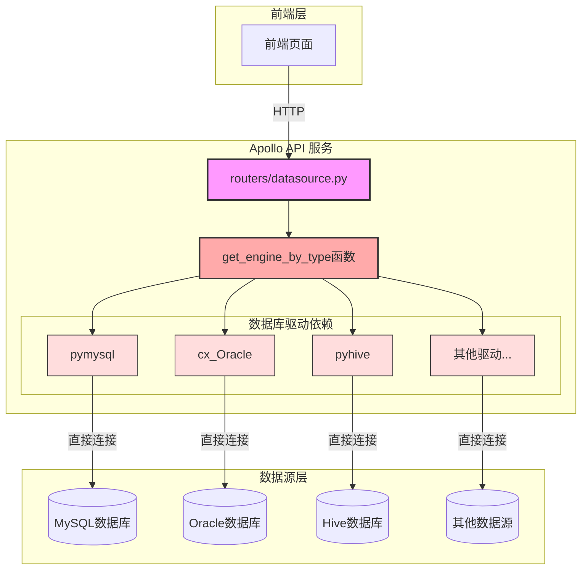

**问题分析**:
- Apollo 直接依赖多种数据库驱动（pymysql、cx_Oracle、pyhive等）
- 通过 `get_engine_by_type()` 函数创建引擎并直接操作数据源
- 造成架构耦合、能力重复、管理分散等问题

**迁移后架构**:

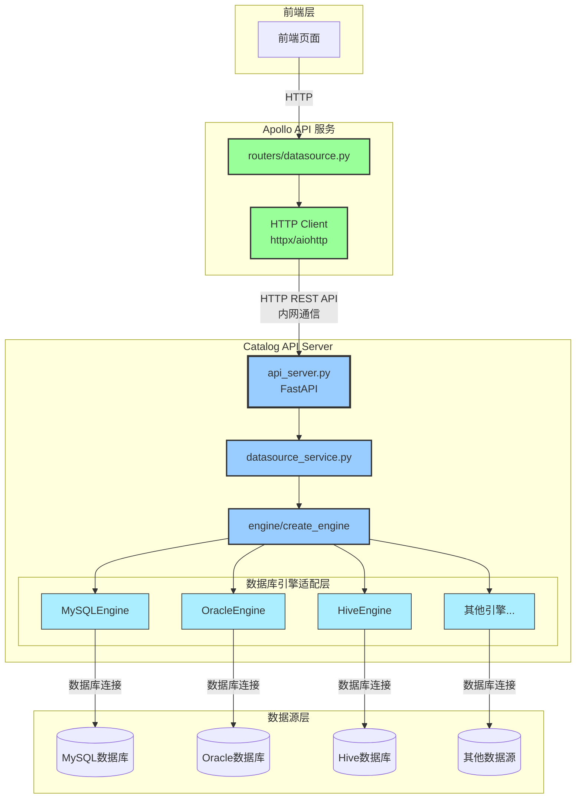

**改进说明**:
- Apollo 通过 HTTP 调用 Catalog 的 API，不再直接依赖数据库驱动
- Catalog 负责数据库引擎的创建和操作，统一管理数据源连接
- 实现架构解耦、能力复用、统一管理的目标

**核心设计思路**:

1. **独立进程部署**: Catalog 新增 `api_server.py` 独立进程，与任务调度进程（`run.py`）分离
2. **引擎复用**: 复用 Catalog 现有的 `engine/` 模块，避免重复实现
3. **权限前置**: 权限校验保留在 Apollo 层，Catalog 只处理业务逻辑
4. **明文传输**: 密码由 Apollo 解密后明文传递给 Catalog（内网通信）
5. **统一错误格式**: Catalog 返回统一格式，Apollo 转换为原有格式

#### 4.1.2. 应用场景

**场景1：用户创建数据源**

1. 用户在前端填写数据源连接信息（IP、端口、用户名、密码等）
2. 用户点击"测试连接"按钮
3. 前端调用 Apollo 的 `/dashboard/datasources/link` 接口
4. Apollo 验证权限后，解密密码，调用 Catalog 的 `/catalog/v1/datasources/testconnection` 接口
5. Catalog 创建数据库引擎并尝试连接
6. 连接成功或失败，Catalog 返回结果
7. Apollo 转换格式后返回给前端
8. 前端显示连接成功或失败信息

**场景2：用户选择数据源中的数据库**

1. 用户在前端选择要扫描的数据库
2. 前端调用 Apollo 的 `/dashboard/datasources/database_info` 接口
3. Apollo 验证权限后，解密密码，调用 Catalog 的 `/catalog/v1/datasources/databases` 接口
4. Catalog 创建数据库引擎并查询数据库列表
5. Catalog 过滤系统数据库，返回数据库列表
6. Apollo 转换格式后返回给前端
7. 前端展示数据库列表供用户选择

**场景3：连接失败处理**

1. 用户测试连接时，数据源网络不可达或密码错误
2. Catalog 尝试连接数据库失败
3. Catalog 捕获异常并返回 `isConnected: false` 和错误信息
4. Apollo 将错误信息返回给前端
5. 前端提示用户检查配置

#### 4.1.3. 对手分析

不涉及

### 4.2. 方案选型

#### 4.2.1. 部署架构方案选型

##### 4.2.1.1 方案1：扩展现有服务（单进程）

在现有 `catalog/run.py` 中增加 FastAPI 服务，任务调度和 API 在同一进程。

**优点**:
- 部署简单，只需修改现有进程
- 减少进程数量

**缺点**:
- API 服务和任务调度相互影响，可能导致任务延迟
- 资源竞争，API 请求高峰期可能影响任务调度
- 单点故障，进程崩溃会同时影响两个功能

**架构示意图**:

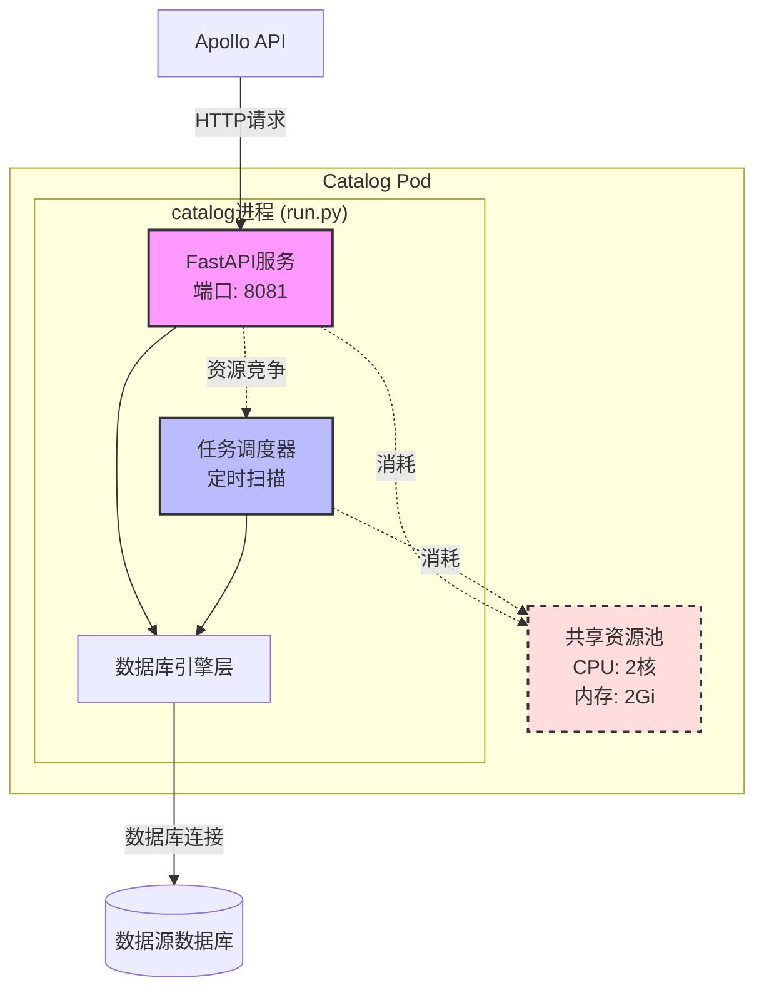

##### 4.2.1.2 方案2：独立进程部署（推荐）

新建 `catalog/api_server.py`，作为 **sidecar 容器**部署在现有 Catalog Deployment 中。

**优点**:
- 职责清晰，API 服务和任务调度互不影响
- 可以独立重启 API 容器，不影响任务调度

**缺点**:
- Pod 内资源需要合理分配（CPU/内存限制）
- 需要打额外的镜像

**架构示意图**:

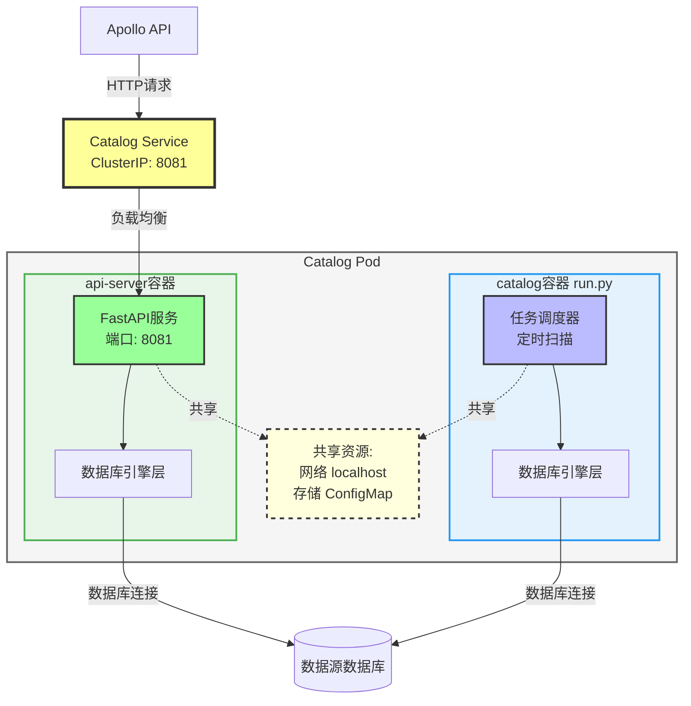

##### 4.2.1.3 方案选型结果

| 方案名称 | 性能 | 可靠性 | 易实现 | 可运维性 |
| -------- | ---- | ------ | -------- | ------ |
| 方案1：单进程 | 中，资源竞争可能影响性能 | 低，单点故障影响范围大 | 高，实现简单 | 中，监控和问题定位较难 |
| 方案2：sidecar容器 | 高，容器隔离性能更好 | 高，故障隔离 | 高，K8s原生支持 | 高，可独立监控和调试 |

**最终选择：方案2 - sidecar 容器部署**

**选择该方案的原因**:

1. **历史遗留**: 调度进程需要依赖supervisor重启功能，使用方案一会导致api服务在扫描阶段时重启不可用。
2. **故障隔离**: API 容器崩溃不影响任务调度容器
3. **资源隔离**: 通过容器资源限制确保互不影响

#### 4.2.2. 通信方式选型

在确定使用 sidecar 容器部署后，需要选择 Apollo 与 Catalog API Server 之间的通信方式。

##### 4.2.2.1 方案1：HTTP REST API（推荐）

使用标准的 HTTP RESTful API 进行通信，Apollo 通过 HTTP 客户端（如 httpx、aiohttp）调用 Catalog API。

**优点**:
- **生态成熟**: HTTP 是最成熟的通信协议，工具链完善（curl、Postman、浏览器等）
- **调试友好**: 可直接通过浏览器或 curl 测试接口，易于排查问题
- **无需依赖**: 不需要引入额外的 RPC 框架或生成客户端代码
- **防火墙友好**: HTTP 协议通常不会被防火墙拦截
- **跨语言**: JSON 格式天然支持跨语言调用
- **监控便利**: 可使用标准的 HTTP 监控工具（Nginx日志、Prometheus等）

**缺点**:
- **性能略低**: 相比 RPC 有一定的序列化和网络开销（但对于本场景可忽略）
- **类型安全**: 需要手动定义数据模型，没有自动生成的类型定义

##### 4.2.2.2 方案2：RPC (gRPC)

使用 gRPC 作为通信协议，通过 Protocol Buffers 定义接口和数据结构。

**优点**:
- **性能高**: 使用 HTTP/2 和 Protobuf，序列化和传输效率更高
- **类型安全**: Protobuf 定义强类型接口，编译时检查
- **双向流**: 支持流式传输（虽然本场景用不到）
- **自动生成代码**: 根据 .proto 文件自动生成客户端和服务端代码

**缺点**:
- **学习成本高**: 团队需要学习 gRPC 和 Protobuf
- **调试困难**: 二进制协议，无法直接用浏览器或 curl 测试
- **依赖复杂**: 需要安装 protoc 编译器，管理 .proto 文件
- **工具链不足**: Python 的 gRPC 工具链不如 Go/Java 成熟
- **防火墙问题**: HTTP/2 可能被某些代理拦截
- **过度设计**: 对于简单的请求-响应场景，gRPC 的优势无法体现

##### 4.2.2.3 方案3：第三方库直接调用

将 Catalog 的数据库引擎层封装为 Python 库（如 `catalog-engine-sdk`），Apollo 直接导入使用。

**优点**:
- **零网络开销**: 进程内调用，无网络延迟
- **类型安全**: Python 类型提示，IDE 自动补全
- **调试方便**: 可以直接断点调试，无需抓包

**缺点**:
- **紧耦合**: Apollo 与 Catalog 的代码强耦合，违反分层架构原则
- **依赖地狱**: Apollo 需要安装所有数据库驱动（pymysql、cx_Oracle、pyhive等）
- **版本管理困难**: 库版本更新需要同步更新所有调用方
- **无法独立部署**: Catalog 的数据库引擎层无法单独升级和维护
- **资源隔离差**: 数据库连接池、超时控制等都在 Apollo 进程内，难以统一管理
- **违背初衷**: 本次迁移的目标就是解耦，使用第三方库方案与目标相悖


##### 4.2.2.4 方案选型结果

| 方案名称 | 性能 | 易用性 | 可调试性 | 可维护性 | 架构解耦 | 团队成本 |
| -------- | ---- | ------ | -------- | -------- | ---- | -------- |
| 方案1：HTTP REST API | 高（内网通信延迟<5ms） | 高，标准HTTP客户端 | 高，可用curl/浏览器测试 | 高，接口清晰独立 | 高，完全解耦 | 低，无学习成本 |
| 方案2：gRPC | 极高（比HTTP快20%左右） | 中，需要生成客户端代码 | 低，二进制协议难调试 | 中，需要维护.proto文件 | 高，完全解耦 | 高，需要学习Protobuf |
| 方案3：第三方库 | 极高（无网络开销） | 高，直接调用函数 | 高，可直接断点 | 低，代码强耦合 | 低，违背解耦目标 | 中，需要管理依赖版本 |

**最终选择：方案1 - HTTP REST API**

**选择该方案的原因**:

1. **符合架构目标**: 完全解耦 Apollo 和 Catalog，通过网络隔离实现模块独立
2. **调试友好**: 可以使用 curl、Postman 等工具快速测试接口，出现问题易于排查
3. **团队熟悉**: 团队对 HTTP REST API 开发经验丰富，无学习成本
4. **生态成熟**: Python 的 HTTP 客户端库（httpx、aiohttp）非常成熟稳定
5. **性能足够**: 内网通信延迟极低（<5ms），对于本场景的性能要求完全满足
6. **可扩展性**: 未来可以轻松切换为外部调用或跨集群调用

**方案排除理由**:
- **排除 gRPC**: 增加复杂度但收益有限，调试困难，团队学习成本高
- **排除第三方库**: 违背本次迁移的解耦目标，会重新引入依赖地狱问题


### 4.3. 静态结构

#### 4.3.1. 模块结构图

```
┌─────────────────────────────────────────────────────────────┐
│                         Apollo API                           │
│  ┌───────────────────────────────────────────────────────┐  │
│  │  routers/datasource.py                                 │  │
│  │  - /dashboard/datasources/link (修改)                  │  │
│  │  - /dashboard/datasources/database_info (修改)         │  │
│  │  调用 Catalog API Server                               │  │
│  └───────────────────────────────────────────────────────┘  │
└─────────────────────────────────────────────────────────────┘
                              ↓ HTTP
┌─────────────────────────────────────────────────────────────┐
│                    Catalog API Server                        │
│  ┌───────────────────────────────────────────────────────┐  │
│  │  api_server.py (新增)                                  │  │
│  │  - FastAPI Application                                 │  │
│  │  - /catalog/v1/datasources/testconnection             │  │
│  │  - /catalog/v1/datasources/databases                   │  │
│  │  - /catalog/v1/health                                 │  │
│  └───────────────────────────────────────────────────────┘  │
│  ┌───────────────────────────────────────────────────────┐  │
│  │  services/datasource_service.py (新增)                 │  │
│  │  - test_connection() - 测试连接                         │  │
│  │  - get_databases() - 获取数据库列表                    │  │
│  └───────────────────────────────────────────────────────┘  │
│  ┌───────────────────────────────────────────────────────┐  │
│  │  engine/ (复用现有)                                    │  │
│  │  - create_engine() - 引擎工厂函数                      │  │
│  │  - MySQLEngine, OracleEngine, HiveEngine...           │  │
│  └───────────────────────────────────────────────────────┘  │
└─────────────────────────────────────────────────────────────┘
                              ↓
┌─────────────────────────────────────────────────────────────┐
│                        数据源数据库                          │
│  MySQL | Oracle | Hive | PostgreSQL | SQL Server | ...     │
└─────────────────────────────────────────────────────────────┘
```

#### 4.3.2. 类关系图

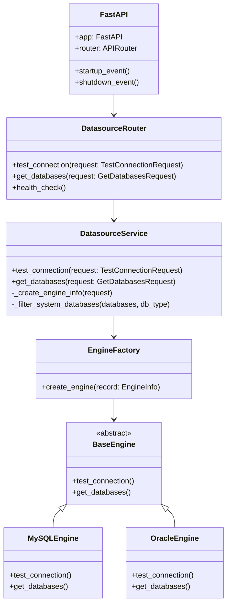

### 4.4. 对软件总体架构的影响

#### 4.4.1. Apollo 架构影响

1. **依赖变更**: Apollo 不再直接依赖数据库驱动（如 pymysql、cx_Oracle 等），改为依赖 Catalog API
2. **配置管理**: 在 Apollo 现有的 ConfigMap `app-config.yaml` 中新增 Catalog API Server 的地址配置
3. **代码修改**: 修改 `routers/datasource.py` 中的两个接口实现，调用 Catalog API

**Apollo ConfigMap 配置示例**（在现有 app-config.yaml 中新增）:

```yaml
# 在现有 ConfigMap app-config.yaml 中新增以下配置
catalog:
  api_base_url: "http://catalog-api-server:8081"
  timeout: 30
```

#### 4.4.2. Catalog 架构影响

1. **新增 sidecar 容器**: 在现有 Catalog Deployment 中新增 API Server 容器
2. **ConfigMap 配置**: 新增 API Server 的 ConfigMap 配置
3. **容器资源分配**: 调整 Pod 资源配置，为 API 容器分配资源
4. **健康检查**: 为 API 容器配置 livenessProbe 和 readinessProbe

#### 4.4.3. 部署架构影响

**迁移前**:
```
┌──────────┐
│  Apollo  │ (直接连接数据源)
└──────────┘
     │
     ↓
┌──────────┐
│ 数据源DB │
└──────────┘

┌─────────────────────┐
│   Catalog Pod       │
│  ┌───────────────┐  │
│  │  run.py       │  │ (任务调度主容器)
│  └───────────────┘  │
└─────────────────────┘
```

**迁移后**:
```
┌──────────┐
│  Apollo  │ ────HTTP(Service)────┐
└──────────┘                       │
                                   ↓
              ┌──────────────────────────────┐
              │      Catalog Pod             │
              │  ┌─────────────────────┐    │
              │  │  api_server.py      │    │ (API sidecar容器)
              │  │  port: 8081         │    │
              │  └─────────────────────┘    │
              │  ┌─────────────────────┐    │
              │  │  run.py             │    │ (任务调度主容器)
              │  └─────────────────────┘    │
              └──────────────────────────────┘
                          │
                          ↓
                   ┌──────────┐
                   │ 数据源DB │
                   └──────────┘
```

**说明**:
- Apollo 通过 Kubernetes Service (ClusterIP) 访问 Catalog API Server
- API Server 作为 sidecar 容器与任务调度容器在同一 Pod 内
- 两个容器通过资源限制实现隔离，共享 Pod 网络
- 配置通过 ConfigMap 挂载到容器中


### 4.5. 概要流程

#### 4.5.1. 测试数据源连接流程

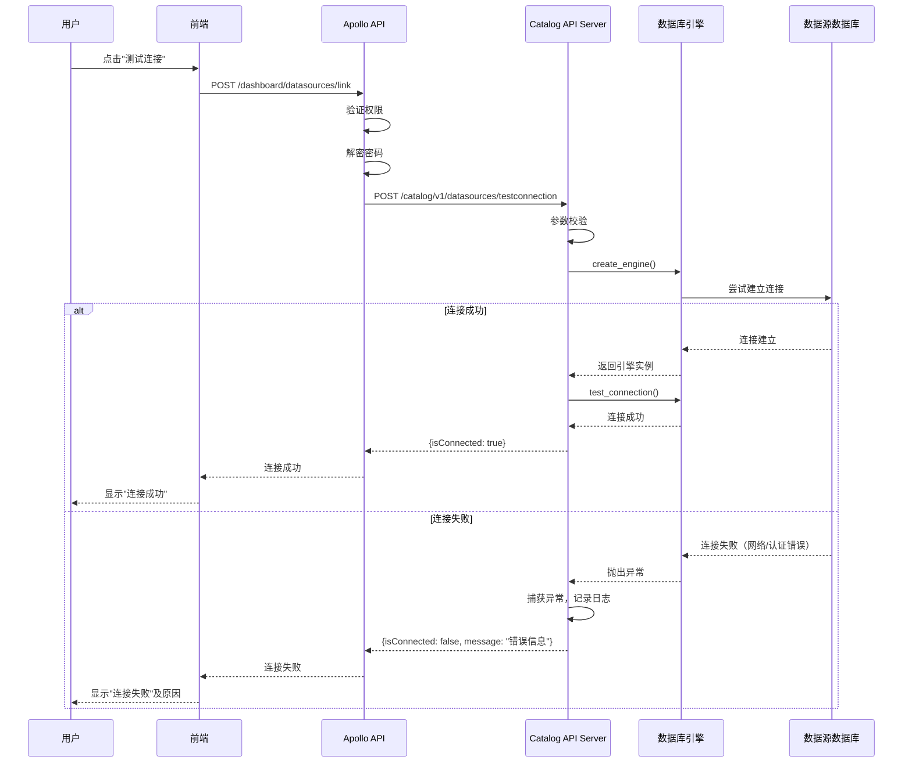

**流程说明**:

1. **权限验证**: Apollo 层完成权限验证，确保用户有 `dsp_classification_config_edit` 权限
2. **密码解密**: Apollo 使用 `KeyTool.decrypt()` 解密密码后传递给 Catalog
3. **参数校验**: Catalog 校验参数完整性（IP、端口、用户名、密码等）
4. **引擎创建**: 调用 `create_engine()` 工厂函数，根据数据源类型创建对应的引擎实例
5. **连接测试**: 引擎尝试建立数据库连接，成功则返回 True，失败则抛出异常
6. **异常处理**: Catalog 捕获所有异常，统一返回 `{isConnected: false}` 和错误信息
7. **格式转换**: Apollo 将 Catalog 的响应转换为原有格式，保持前端兼容

#### 4.5.2. 获取数据库列表流程

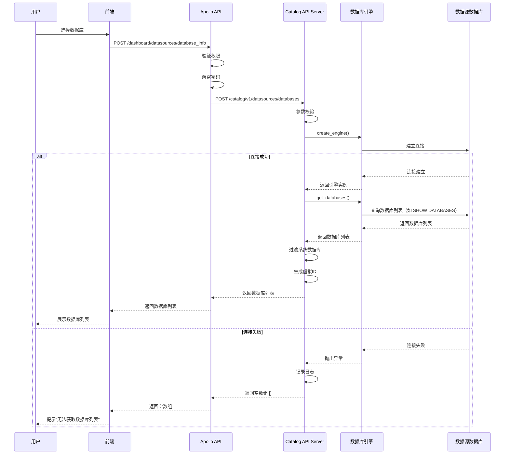

**流程说明**:

1. **权限验证**: Apollo 层验证用户有 `dsp_classification_config_query` 权限
2. **密码解密**: 同测试连接流程
3. **连接创建**: 创建引擎并建立连接
4. **查询数据库**: 根据数据源类型执行不同的查询语句
   - MySQL: `SHOW DATABASES`
   - Oracle: 查询 `DBA_TABLESPACES` 或 `ALL_USERS`
   - SQL Server: 查询 `sys.databases` 和 `sys.schemas`
   - Hive: `SHOW DATABASES`
5. **过滤系统库**: 根据预定义的规则过滤系统数据库
   - MySQL: 过滤 `information_schema`, `performance_schema`, `mysql`, `sys`
   - Oracle: 过滤 `SYS`, `SYSTEM`, `SYSAUX` 等
6. **生成虚拟ID**: 为每个数据库生成唯一的虚拟ID（从1开始递增）
7. **返回结果**: 返回包含 `id`, `name`, `type`, `children` 的数组

#### 4.5.3. Apollo 接口适配流程

Apollo 需要将原有的直接操作逻辑改为调用 Catalog API：

**修改前**:
```python
# apolloserver/apollo_api/routers/datasource.py
@router.post("/dashboard/datasources/link")
async def test_datasources_connect(input: schemas.DataSourceTestConnect):
    res, engine = get_engine_by_type(input, res)  # 直接操作
    return res
```

**修改后**:
```python
# apolloserver/apollo_api/routers/datasource.py
@router.post("/dashboard/datasources/link")
async def test_datasources_connect(input: schemas.DataSourceTestConnect):
    # 解密密码
    if hasattr(input.option, "password") and input.option.password is not None:
        input.option.password = KeyTool.decrypt(input.option.password)

    # 调用 Catalog API
    catalog_url = f"{CATALOG_API_BASE_URL}/catalog/v1/datasources/testconnection"
    response = await http_client.post(catalog_url, json=input.dict())

    # 转换格式（保持原有格式）
    if response.status_code == 200:
        result = response.json()
        if result["code"] == "Success":
            return result["data"]
        else:
            return {"isConnected": False, "message": result["message"]}
    else:
        return {"isConnected": False, "message": "Catalog service error"}
```

### 4.6. 关键特性设计

#### 4.6.1. 安全性设计

##### 4.6.1.1. 安全兜底机制合入

根据产品安全兜底机制要求，本模块设计满足以下安全项：

| 安全项 | 要求 | 本模块实现 | 状态 |
|-------|------|-----------|------|
| 输入校验 | 所有外部输入必须校验 | 使用 Pydantic 模型校验所有请求参数 | ✓ |
| SQL注入防护 | 禁止拼接SQL | 使用 SQLAlchemy ORM，参数化查询 | ✓ |
| 命令注入防护 | 禁止执行外部命令 | 不涉及命令执行 | ✓ |
| 密码存储 | 禁止明文存储密码 | 内存中临时使用，不持久化 | ✓ |
| 传输加密 | 敏感信息加密传输 | 内网通信，网络隔离 | ✓ |
| 日志脱敏 | 日志禁止包含敏感信息 | 密码字段使用 `***` 脱敏 | ✓ |
| 错误信息 | 错误信息不暴露内部细节 | 返回通用错误描述 | ✓ |

**安全兜底机制检查清单已填写，详见附件《模块概要设计-安全兜底机制合入checklist.xlsx》。**

##### 4.6.1.2. 威胁建模分析

本模块不涉及新的外部暴露端口和协议，Catalog API Server 仅在内网提供服务，由产线安全经理判断无需执行威胁建模分析。

##### 4.6.1.3. 安全设计

###### 4.6.1.3.1. 参数校验安全设计

**威胁**: 恶意用户构造特殊参数进行攻击（如SQL注入、命令注入、路径遍历等）

**安全机制**:

1. **Pydantic模型校验**: 所有请求参数使用 Pydantic 模型定义，自动进行类型检查和格式校验
   ```python
   class TestConnectionRequest(BaseModel):
       type: str = Field(..., regex="^[A-Za-z]+$")  # 只允许字母
       ip: Optional[str] = Field(None, regex="^[0-9.]+$")  # IP格式校验
       port: Optional[int] = Field(None, ge=1, le=65535)  # 端口范围校验
       option: Dict[str, Any]
   ```

2. **白名单校验**: 数据源类型使用枚举类型，只接受预定义的值
   ```python
   class DataSourceType(str, Enum):
       MySQL = "MySQL"
       Oracle = "Oracle"
       # ... 其他类型
   ```

3. **长度限制**: 对字符串类型的参数设置最大长度限制，防止DoS攻击
   ```python
   username: str = Field(..., max_length=128)
   password: str = Field(..., max_length=256)
   ```

###### 4.6.1.3.2. 数据库连接安全设计

**威胁**: 密码明文传输被窃取、数据库连接配置泄漏

**安全机制**:

1. **网络隔离**: Apollo 和 Catalog 部署在同一内网，通过防火墙隔离外网访问
2. **密码生命周期**: 密码在内存中临时使用，连接完成后立即释放，不持久化到磁盘或日志
3. **连接超时**: 设置合理的连接超时时间（默认30秒），防止长时间占用连接
4. **连接池限制**: 限制连接池大小，防止连接耗尽攻击

###### 4.6.1.3.3. 错误信息安全设计

**威胁**: 错误信息暴露内部实现细节，被攻击者利用

**安全机制**:

1. **通用错误描述**: 对外返回的错误信息使用通用描述，不包含技术细节
   ```python
   # 正确示例
   return {"isConnected": False, "message": "连接失败，请检查配置"}

   # 错误示例（不要这样做）
   return {"isConnected": False, "message": f"MySQL错误: {str(exception)}"}
   ```

2. **异常分类**: 区分用户错误和系统错误，用户错误返回详细信息，系统错误返回通用信息
3. **详细日志记录**: 完整的异常堆栈记录到服务端日志，供排查使用

##### 4.6.1.4. 预使用组件版本合规性及版本漏洞情况

本模块复用 Catalog 现有组件，无新增外部依赖。不涉及。

#### 4.6.2. 可靠性设计

##### 4.6.2.1. 承载载体可靠

###### 4.6.2.1.1 进程/服务可靠性

**API Server 容器故障检测与恢复**:

1. **健康检查**: 配置 `/catalog/v1/health` 接口作为 livenessProbe 和 readinessProbe
2. **自动重启**: Kubernetes 自动重启崩溃的容器（restartPolicy: Always）
3. **重启延迟**: 配置 failureThreshold 和 periodSeconds 避免频繁重启
4. **启动探测**: 使用 startupProbe 确保容器正常启动后才接收流量

**Kubernetes 容器配置示例**:
```yaml
containers:
- name: api-server
  image: catalog-api-server:latest
  ports:
  - containerPort: 8081
    name: http
  resources:
    requests:
      cpu: "50m"
      memory: "128Mi"
    limits:
      cpu: "800m"
      memory: "512Mi"
  livenessProbe:
    httpGet:
      path: /catalog/v1/health
      port: 8081
    initialDelaySeconds: 300
    periodSeconds: 10
    failureThreshold: 3
    timeoutSeconds: 10
  readinessProbe:
    httpGet:
      path: /catalog/v1/health
      port: 8081
    initialDelaySeconds: 30
    periodSeconds: 5
    timeoutSeconds: 5
    successThreshold: 1
    failureThreshold: 3
  volumeMounts:
  - name: config
    mountPath: /etc/catalog
    readOnly: true
```

###### 4.6.2.1.2 服务冗余机制

**支持多实例部署**:

1. **无状态设计**: API Server 不维护任何状态，所有请求独立处理
2. **负载均衡**: 在 Kubernetes 中部署多个 Pod，通过 Service 进行负载均衡

**Kubernetes Deployment 配置**（sidecar 容器部署）:

```yaml
apiVersion: apps/v1
kind: Deployment
metadata:
  name: catalog
  namespace: dsp
spec:
  replicas: 2
  selector:
    matchLabels:
      app: catalog
  template:
    metadata:
      labels:
        app: catalog
    spec:
      containers:
      # 主容器：Catalog 调度任务
      - name: catalog
        image: catalog:latest
        command: ["python", "run.py"]
        resources:
          requests:
            cpu: "150m"   # 200m -> 150m
            memory: "900Mi"  # 1Gi -> 900Mi
          limits:
            cpu: "800m" # 1 -> 800m
            memory: "31Gi"  # 32Gi -> 2Gi
        volumeMounts:
        - name: config
          mountPath: /etc/catalog
          readOnly: true

      # Sidecar 容器：Catalog API Server
      - name: api-server
        image: catalog:latest
        command: ["python", "api_server.py"]
        ports:
        - containerPort: 8081
          name: http
          protocol: TCP
        resources:
          requests:
            cpu: "50m"
            memory: "100Mi"
          limits:
            cpu: "200m"
            memory: "500Mi"
        livenessProbe:
          httpGet:
            path: /catalog/v1/health
            port: 8081
          initialDelaySeconds: 30
          periodSeconds: 10
          failureThreshold: 3
        readinessProbe:
          httpGet:
            path: /catalog/v1/health
            port: 8081
          initialDelaySeconds: 5
          periodSeconds: 5
          failureThreshold: 3
        startupProbe:
          httpGet:
            path: /catalog/v1/health
            port: 8081
          initialDelaySeconds: 0
          periodSeconds: 5
          failureThreshold: 30
        volumeMounts:
        - name: config
          mountPath: /etc/catalog
          readOnly: true

      volumes:
      - name: config
        configMap:
          name: catalog-config

---
apiVersion: v1
kind: Service
metadata:
  name: catalog-api-server
  namespace: dsp
spec:
  type: ClusterIP
  ports:
  - port: 8081
    targetPort: 8081
    protocol: TCP
    name: http
  selector:
    app: catalog
```

###### 4.6.2.1.3 数据可靠性

本模块不涉及数据持久化，所有数据在内存中临时处理，无需考虑数据恢复。

##### 4.6.2.2. 周边无影响

**资源隔离机制**:

1. **CPU限制**: Kubernetes 配置 CPU 限制为 2 核
   ```yaml
   resources:
     limits:
       cpu: "200m"
     requests:
       cpu: "50m"
   ```

2. **内存限制**: Kubernetes 配置内存限制为 1GB
   ```yaml
   resources:
     limits:
       memory: "1Gi"
     requests:
       memory: "200Mi"
   ```

3. **超时控制**: 所有数据库连接设置超时时间（默认30秒），防止长时间阻塞

##### 4.6.2.3. 业务流程可靠（FMEA分析）

**功能要求对齐**:

- **F1-测试数据源连接功能**: 30秒内返回连接测试结果，成功率>99%（排除数据源自身故障）
- **F2-获取数据库列表功能**: 30秒内返回数据库列表，成功率>99%（排除数据源自身故障）
- **F3-健康检查功能**: 1秒内返回健康状态，成功率>99.9%

**FMEA分析时序图**:

**关键功能1：测试数据源连接**

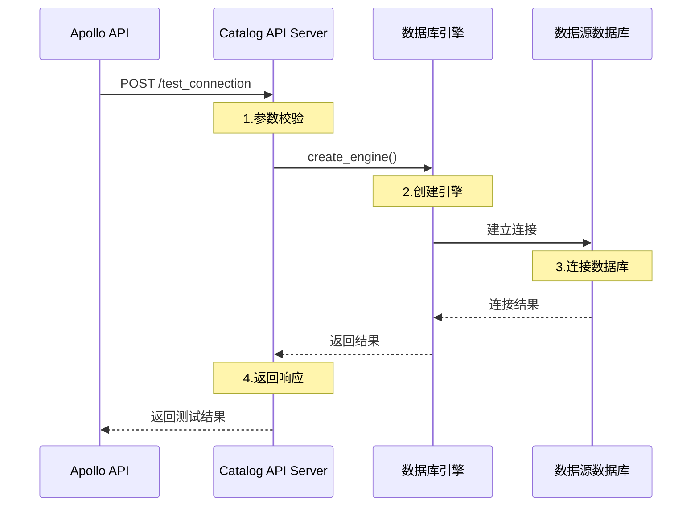

**关键功能2：获取数据库列表**

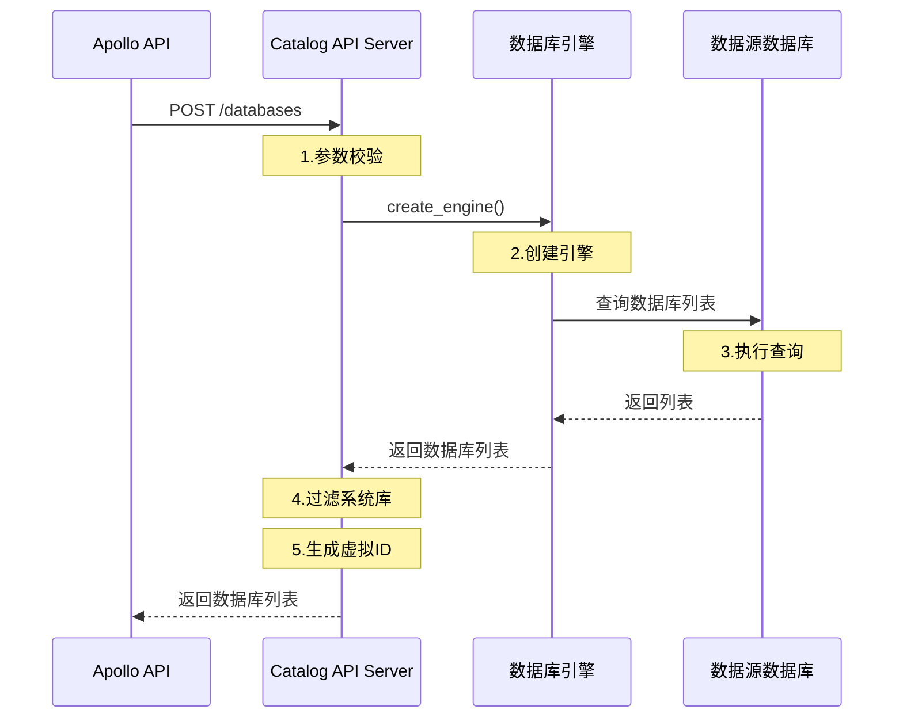

**FMEA分析表格**:

| 失效模式 | 失效原因(围绕输入/执行/输出) | 失效影响(对产品核心能力) | 严重程度(S) | 发生频度(O) | 可探测度(D) | RPN | 改进措施(重点保证业务成功) |
|----------|----------|----------|-------------|-------------|-------------|-----|----------|
| **F1-测试连接失效** | 【输入】Apollo传递的参数不完整（缺少IP/端口） | 用户无法测试连接，影响数据源创建流程 | 7 | 2 | 2 | 28 | 1.参数校验，缺少必填字段立即返回错误<br>2.日志记录详细错误信息 |
| **F1-测试连接超时** | 【执行】数据源网络不可达，连接超时 | 用户等待时间过长，体验差 | 6 | 5 | 3 | 90 | 1.设置连接超时为30秒<br>2.超时后立即返回失败，不重试<br>3.返回明确的超时错误信息 |
| **F1-测试连接慢** | 【执行】数据源响应慢，但未超时 | 用户体验差，但不影响功能 | 4 | 3 | 4 | 48 | 1.优化超时时间配置 |
| **F1-测试连接不完整** | 【输出】引擎创建成功但未真正测试连接 | 用户以为连接成功，实际不可用 | 9 | 1 | 3 | 27 | 1.引擎创建后执行实际查询验证<br>2.捕获所有异常，返回准确状态 |
| **F2-获取数据库列表失效** | 【输入】密码错误，认证失败 | 用户无法选择数据库，影响数据源配置 | 7 | 4 | 2 | 56 | 1.返回明确的认证失败错误<br>2.日志记录认证失败详情 |
| **F2-获取数据库列表超时** | 【执行】数据库实例过多，查询超时 | 用户无法完成数据源配置 | 8 | 3 | 3 | 72 | 1.设置查询超时为30秒<br>2.考虑分页查询|
| **F2-获取数据库列表慢** | 【执行】数据库实例过多（>1000个） | 用户等待时间长，体验差 | 5 | 4 | 4 | 80 | 1.优化查询语句，只查询必要字段<br>2.前端显示加载进度< |
| **F2-获取数据库列表不完整** | 【执行】系统数据库未过滤 | 用户看到不应该看到的系统库，混淆 | 3 | 2 | 5 | 30 | 1.维护系统数据库黑名单|
| **API Server进程崩溃** | 【执行】未捕获的异常导致进程退出 | 所有连接测试和查询功能不可用 | 10 | 2 | 2 | 40 | 1.全局异常捕获<br>2.Kubernetes自动重启容器|
| **内存泄漏** | 【执行】连接对象未正确释放，内存持续增长 | 服务长时间运行后性能下降甚至崩溃 | 8 | 2 | 5 | 80 | 1.使用with语句管理引擎生命周期 |

**本迭代需要解决的故障**:

根据RPN优先级排序(RPN=S×O×D)，本迭代重点解决：

1. **最高优先级(RPN≥80)**:
   - **F1-测试连接超时(RPN=90)**: 设置30秒超时，超时立即返回，记录详细日志
   - **F2-获取数据库列表慢(RPN=80)**: 优化查询语句
   - **内存泄漏(RPN=80)**: 使用with管理引擎生命周期，添加内存监控

2. **高优先级(50≤RPN<80)**:
   - **F2-获取数据库列表超时(RPN=72)**: 设置30秒超时，考虑分页查询
   - **F2-获取数据库列表失效(RPN=56)**: 返回明确的认证失败错误

3. **解决措施方向**:
   - **超时控制**: 所有数据库操作设置明确的超时时间
   - **资源管理**: 使用上下文管理器确保资源正确释放
   - **监控告警**: 监控关键指标（响应时间、错误率、内存使用），异常时告警

#### 4.6.3. 可测试性设计

##### 4.6.3.1. 测试方案

所有的配置在configmap中可修改，测试人员可根据测试点进行修改测试。

#### 4.6.4. 可调试性设计

##### 4.6.4.1. 调试接口

**日志级别动态调整**:

提供接口动态调整日志级别，无需重启服务：
```
POST /catalog/v1/debug/loglevel
{
  "level": "DEBUG"
}
```

#### 4.6.5. 可运维性设计


##### 4.6.5.1. 监控指标

**Prometheus 指标**（参考 Apollo 项目 api_metrics.py 实现）:

1. **API 请求时延**: `catalog_api_latency_seconds` (Histogram)
   - 标签: `endpoint`, `method`
   - buckets: `[3, 10, 30, 60, 180, 300, 600]`

2. **API 请求总数**: `catalog_api_requests_total` (Counter)
   - 标签: `endpoint`, `status`, `method`
   - status: `2xx` 或 `non-2xx`

**指标实现示例**:

```python
from prometheus_client import Histogram, Counter, REGISTRY, generate_latest, CONTENT_TYPE_LATEST

# 指标一：Catalog API 请求时延 Histogram
CATALOG_API_LATENCY_HISTOGRAM = Histogram(
    'catalog_api_latency_seconds',
    'Catalog API request latency in seconds',
    ['endpoint', 'method'],
    buckets=[3, 10, 30, 60, 180, 300, 600]
)

# 指标二：Catalog API 请求总数 Counter
CATALOG_API_REQUEST_COUNTER = Counter(
    'catalog_api_requests_total',
    'Total number of Catalog API requests',
    ['endpoint', 'status', 'method']
)

# 指标记录函数（提供给中间件调用）
def record_api_latency(endpoint: str, method: str, duration: float):
    CATALOG_API_LATENCY_HISTOGRAM.labels(
        endpoint=endpoint,
        method=method
    ).observe(duration)

def record_api_request(endpoint: str, status_code: int, method: str):
    # 将状态码归类：2xx与非2xx
    status = "2xx" if 200 <= status_code < 300 else "non-2xx"
    CATALOG_API_REQUEST_COUNTER.labels(
        endpoint=endpoint,
        status=status,
        method=method
    ).inc()

# 获取所有指标数据（供 /metrics 接口使用）
def get_metrics():
    return generate_latest(REGISTRY)

def get_metrics_content_type():
    return CONTENT_TYPE_LATEST
```

**指标采集**:

使用 FastAPI 中间件自动采集：

```python
from starlette.middleware.base import BaseHTTPMiddleware
import time

class MetricsMiddleware(BaseHTTPMiddleware):
    async def dispatch(self, request, call_next):
        start_time = time.time()
        response = await call_next(request)
        duration = time.time() - start_time

        # 记录指标
        endpoint = request.url.path
        method = request.method
        record_api_latency(endpoint, method, duration)
        record_api_request(endpoint, response.status_code, method)

        return response
```

**暴露指标端点**:

```python
@app.get("/metrics")
async def metrics():
    from prometheus_client import generate_latest, CONTENT_TYPE_LATEST
    return Response(content=generate_latest(), media_type=CONTENT_TYPE_LATEST)
```

#### 4.6.6. 可扩展性设计

##### 4.6.6.1. 水平扩展

**无状态设计**: API Server 不维护任何状态，支持任意数量的实例

**负载均衡**: 在 Kubernetes 中通过 Service 自动负载均衡

##### 4.6.6.2. 功能扩展

**新增数据源类型**: 在 `engine/` 目录下新增引擎实现类，在工厂函数中注册即可

**新增接口**: 在 `routers/` 目录下新增路由即可，无需修改核心逻辑

#### 4.6.7. 可复用性设计

##### 4.6.7.1. 本模块可采用的公用代码

1. **Catalog 现有引擎适配层**: 复用 `catalog/engine/` 模块，包括所有数据库引擎实现
2. **Catalog 配置管理**: 复用 `catalog/conf/config.py` 配置加载机制
3. **Catalog 日志工具**: 复用 `catalog/utils/` 中的日志工具
4. **Catalog 密码解密**: 复用 `catalog/utils/keytool.py` 密钥工具

##### 4.6.7.2. 本模块可产出的公用代码

1. **FastAPI 基础框架**: API Server 的基础框架（路由注册、中间件、异常处理）可供其他模块复用
2. **参数校验模型**: Pydantic 模型定义可供其他需要数据源配置的模块复用
3. **数据库连接管理**: 连接池管理和超时控制机制可供其他模块复用

#### 4.6.8. 跨平台设计和平台差异处理

本模块基于 Python 开发，天然支持跨平台（Linux x86/ARM、Windows、macOS）。

### 4.7. 方案风险分析

| 风险点 | 风险预研结果/风险规避措施 |
|-------|------------------------|
| **风险1**: Apollo 调用 Catalog 的网络延迟可能影响用户体验 | **规避措施**: 1.设置合理的超时时间; |
| **风险2**: Catalog API Server 单点故障导致所有连接测试不可用 | **规避措施**: 1.部署多个实例进行负载均衡; 2.设置健康检查和自动重启;  |
| **风险3**: 密码明文传输可能被中间人攻击 | **规避措施**: 1.确保 Apollo 和 Catalog 部署在同一安全内网;  |

## 5. 数据结构设计

### 5.1. 配置文件定义

#### 5.1.1. Catalog API Server 配置

**配置文件路径**: `/etc/catalog/api_server.yaml`

**配置项定义**:

```yaml
# API Server 配置
server:
  host: "0.0.0.0"              # 监听地址
  port: 8081                    # 监听端口
  workers: 4                    # 工作进程数

# 数据库连接配置
database:
  connection_timeout: 30        # 连接超时（秒）
  query_timeout: 30             # 查询超时（秒）
```

#### 5.1.2. Apollo 配置修改

**新增配置项**:

```yaml
# Catalog API Server 地址
catalog:
  api_base_url: "http://catalog-api-server:8081"  # Catalog API Server 地址
  timeout: 10                                      # 请求超时（秒）s
```

### 5.2. 全局数据结构定义

#### 5.2.1. 请求参数数据结构

**TestConnectionRequest** - 测试连接请求:

```python
from pydantic import BaseModel, Field, validator
from typing import Optional, Dict, Any, Union
from enum import Enum

class DataSourceType(str, Enum):
    MySQL = "MySQL"
    Oracle = "Oracle"
    SQLServer = "SQLServer"
    Hive = "Hive"
    PostgreSQL = "PostgreSQL"
    DB2 = "DB2"
    # ... 其他数据源类型

class OracleServiceType(str, Enum):
    Sid = "sid"
    Service = "service"

class HiveConnectionType(str, Enum):
    Kerberos = "kerberos"
    NoAuth = "no_auth"

# 基础 Option 模型
class DataSourceConnectOption(BaseModel):
    username: Optional[str] = Field(None, min_length=1, max_length=64)
    password: Optional[str] = Field(None, min_length=1, max_length=1024)

# Oracle Option 模型（需要校验 conn_type/sid/service）
class OracleDataSourceConnectOption(BaseModel):
    username: Optional[str] = Field(None, min_length=1, max_length=64)
    password: Optional[str] = Field(None, min_length=1, max_length=1024)
    sid: str = Field("", max_length=64)
    service: str = Field("", max_length=64)
    conn_type: OracleServiceType

    @validator('sid')
    def validate_sid(cls, v, values):
        """如果 conn_type 为 sid，则 sid 不能为空"""
        conn_type = values.get('conn_type')
        if conn_type == OracleServiceType.Sid and not v:
            raise ValueError('sid is required when conn_type is sid')
        return v

    @validator('service')
    def validate_service(cls, v, values):
        """如果 conn_type 为 service，则 service 不能为空"""
        conn_type = values.get('conn_type')
        if conn_type == OracleServiceType.Service and not v:
            raise ValueError('service is required when conn_type is service')
        return v

# DB2 Option 模型（需要校验 databasename）
class DB2DataSourceConnectOption(BaseModel):
    username: Optional[str] = Field(None, min_length=1, max_length=64)
    password: Optional[str] = Field(None, min_length=1, max_length=1024)
    databasename: str = Field(..., min_length=1, max_length=256)

# Hive Option 模型（需要校验 Kerberos 相关字段）
class HiveDataSourceConnectOption(BaseModel):
    conn_type: HiveConnectionType = Field(...)
    hive_username: Optional[str] = Field(None, min_length=1, max_length=64)
    kerberos_username: Optional[str] = Field(None, min_length=1, max_length=64)
    password: str = Field(None, min_length=0, max_length=1024)
    keytab_file_content: Optional[str] = None
    keytab_file_name: Optional[str] = Field(None, max_length=20)
    kerberos_host_ip: Optional[str] = Field(None, max_length=20)
    kerberos_port: int = Field(88, ge=0, le=65535)

    @validator('kerberos_username')
    def validate_kerberos_username(cls, v, values):
        """Kerberos 认证需要验证用户名格式"""
        conn_type = values.get('conn_type')
        if conn_type == HiveConnectionType.Kerberos and v:
            # 验证 Kerberos principal 格式
            if '@' not in v:
                raise ValueError('kerberos username must contain @ symbol')
        return v

    @validator('kerberos_host_ip')
    def validate_kerberos_host_ip(cls, v, values):
        """Kerberos 认证需要提供 KDC 主机 IP"""
        conn_type = values.get('conn_type')
        if conn_type == HiveConnectionType.Kerberos and not v:
            raise ValueError('kerberos_host_ip is required for kerberos authentication')
        return v

def get_option_model(data_source_type: DataSourceType):
    """根据数据源类型动态选择 Option 模型（参考 Apollo 实现）"""
    if data_source_type == DataSourceType.Oracle:
        return OracleDataSourceConnectOption
    elif data_source_type == DataSourceType.DB2:
        return DB2DataSourceConnectOption
    elif data_source_type == DataSourceType.Hive:
        return HiveDataSourceConnectOption
    else:
        return DataSourceConnectOption

class TestConnectionRequest(BaseModel):
    """测试数据源连接请求"""
    reqId: str = Field(..., description="请求追踪ID")
    type: DataSourceType = Field(..., description="数据源类型")
    ip: Optional[str] = Field(None, description="数据源IP地址")
    port: Optional[int] = Field(None, ge=1, le=65535, description="数据源端口")
    option: Union[
        DataSourceConnectOption,
        OracleDataSourceConnectOption,
        DB2DataSourceConnectOption,
        HiveDataSourceConnectOption
    ] = Field(..., description="连接配置项")

    @validator('option', pre=True)
    def validate_option(cls, v, values):
        """根据 type 动态校验 option 字段"""
        if isinstance(v, dict):
            data_source_type = values.get('type')
            option_model = get_option_model(data_source_type)
            return option_model(**v)
        return v

    class Config:
        schema_extra = {
            "example": {
                "reqId": "req-123456",
                "type": "MySQL",
                "ip": "192.168.1.100",
                "port": 3306,
                "option": {
                    "username": "root",
                    "password": "password"
                }
            }
        }
```

**GetDatabasesRequest** - 获取数据库列表请求:

```python
class GetDatabasesRequest(BaseModel):
    """获取数据库列表请求（与 TestConnectionRequest 结构相同）"""
    reqId: str = Field(..., description="请求追踪ID")
    type: DataSourceType = Field(..., description="数据源类型")
    ip: Optional[str] = Field(None, description="数据源IP地址")
    port: Optional[int] = Field(None, ge=1, le=65535, description="数据源端口")
    option: Union[
        DataSourceConnectOption,
        OracleDataSourceConnectOption,
        DB2DataSourceConnectOption,
        HiveDataSourceConnectOption
    ] = Field(..., description="连接配置项")

    @validator('option', pre=True)
    def validate_option(cls, v, values):
        """根据 type 动态校验 option 字段"""
        if isinstance(v, dict):
            data_source_type = values.get('type')
            option_model = get_option_model(data_source_type)
            return option_model(**v)
        return v
```

**参数校验说明**（参考 Apollo 项目 datasource.py 实现）:

1. **Oracle 校验**:
   - `conn_type` 为 `sid` 时，`sid` 字段不能为空
   - `conn_type` 为 `service` 时，`service` 字段不能为空

2. **DB2 校验**:
   - `databasename` 字段必填，长度 1-256

3. **Hive 校验**:
   - `conn_type` 为 `kerberos` 时，`kerberos_host_ip` 不能为空
   - `kerberos_username` 需包含 `@` 符号
   - 使用 Pydantic 的 `validator` 装饰器进行条件校验

#### 5.2.2. 响应数据结构

**BaseResponse** - 基础响应:

```python
from typing import TypeVar, Generic, Optional

T = TypeVar('T')

class BaseResponse(BaseModel, Generic[T]):
    """统一响应格式"""
    code: str = Field("Success", description="错误码")
    message: str = Field("", description="消息描述")
    data: Optional[T] = Field(None, description="响应数据")

    class Config:
        schema_extra = {
            "example": {
                "code": "Success",
                "message": "操作成功",
                "data": {}
            }
        }
```

**TestConnectionResponse** - 测试连接响应:

```python
class TestConnectionData(BaseModel):
    """测试连接响应数据"""
    isConnected: bool = Field(..., description="是否连接成功")

class TestConnectionResponse(BaseResponse[TestConnectionData]):
    """测试连接响应"""
    pass
```

**DatabaseInfo** - 数据库信息:

```python
class DatabaseInfo(BaseModel):
    """数据库信息"""
    id: int = Field(..., description="虚拟ID")
    name: str = Field(..., description="数据库名称")
    type: str = Field(..., description="类型：database 或 schema")
    children: List = Field(default_factory=list, description="子节点（预留）")

class GetDatabasesResponse(BaseResponse[List[DatabaseInfo]]):
    """获取数据库列表响应"""
    pass
```

#### 5.2.3. 内部数据结构

**EngineInfo** - 引擎信息:

```python
class EngineInfo:
    """数据库引擎信息（复用 Catalog 现有定义）"""
    def __init__(self):
        self.type = None           # 数据源类型
        self.ip = None             # IP地址
        self.port = None           # 端口
        self.option = None         # 连接配置
        self.databasename = None   # 数据库名（部分类型需要）
        self.datasource_id = None  # 数据源ID（可选）
```

**SystemDatabaseFilters** - 系统数据库过滤规则:

```python
# 系统数据库黑名单
SYSTEM_DATABASE_FILTERS = {
    "MySQL": [
        "information_schema",
        "performance_schema",
        "mysql",
        "sys"
    ],
    "Oracle": [
        "SYS",
        "SYSTEM",
        "SYSAUX",
        "SYSMAN",
        "DBSNMP",
        "OUTLN",
        "MGMT_VIEW",
        "FLOWS_FILES",
        "MDSYS",
        "ORDSYS",
        "EXFSYS",
        "WMSYS",
        "CTXSYS",
        "XDB",
        "ANONYMOUS",
        "APEX_PUBLIC_USER",
        "DIP",
        "ORACLE_OCM",
        "SPATIAL_CSW_ADMIN_USR",
        "SPATIAL_WFS_ADMIN_USR"
    ],
    "SQLServer": [
        "master",
        "tempdb",
        "model",
        "msdb",
        "ReportServer",
        "ReportServerTempDB"
    ],
    "PostgreSQL": [
        "template0",
        "template1"
    ],
    "Hive": []
}
```

## 6. 流程设计

### 6.1. Catalog API Server 模块

#### 6.1.1. 静态结构

**代码目录结构**（在现有结构基础上新增 API Server 相关文件）:

```
catalog/
├── api_server.py                  # API Server 主入口（新增，在最外层）
├── run.py                         # 调度任务主入口（现有）
│
├── api/                           # API 相关代码目录（新增）
│   ├── __init__.py
│   ├── routers/                   # 路由层
│   │   ├── __init__.py
│   │   └── datasource_router.py  # 数据源相关路由
│   ├── services/                  # 业务逻辑层
│   │   ├── __init__.py
│   │   └── datasource_service.py # 数据源业务逻辑
│   ├── schemas/                   # 数据模型层
│   │   ├── __init__.py
│   │   ├── request_schemas.py    # 请求数据结构
│   │   └── response_schemas.py   # 响应数据结构
│   ├── middleware/                # 中间件
│   │   ├── __init__.py
│   │   ├── metrics_middleware.py # 监控指标中间件
│   │   └── logging_middleware.py # 日志中间件
│   └── monitor/                   # 监控模块
│       ├── __init__.py
│       └── metrics.py             # Prometheus 指标定义
│
├── engine/                        # 数据库引擎层（现有，共用）
│   ├── __init__.py
│   ├── create_engine.py          # 引擎工厂
│   ├── mysql_engine.py
│   ├── oracle_engine.py
│   └── ...
│
└── ... (其他现有目录保持不变)
```

**新增文件说明**:

- **api_server.py**: FastAPI 应用主入口，启动 API Server（在最外层目录）
- **api/**: API 相关代码目录，包含路由、服务、数据模型、中间件、监控等模块
- **engine/**: 数据库引擎层，被 API Server 和调度任务共同复用

**调度任务代码**: 保持现有目录结构不变

#### 6.1.2. 处理流程

##### 6.1.2.1. 测试连接流程

**函数调用链**:

```
datasource_router.test_connection()
  ↓
datasource_service.test_connection()
  ↓
datasource_service._create_engine_info()
  ↓
engine.create_engine()  [复用Catalog现有]
  ↓
engine.test_connection()
```

**流程图**:

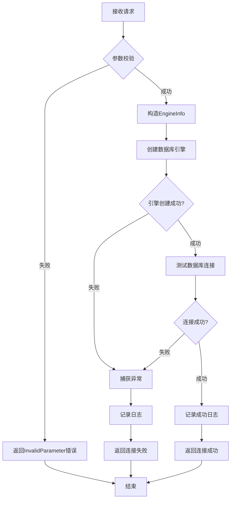

##### 6.1.2.2. 获取数据库列表流程

**函数调用链**:

```
datasource_router.get_databases()
  ↓
datasource_service.get_databases()
  ↓
datasource_service._create_engine_info()
  ↓
engine.create_engine()
  ↓
engine.get_databases()  [调用特定数据库的查询方法]
  ↓
datasource_service._filter_system_databases()
  ↓
datasource_service._generate_virtual_ids()
```

**流程图**:

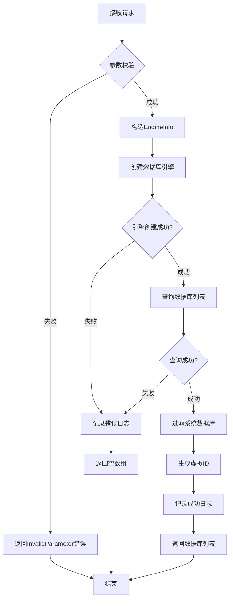

#### 6.1.3. 关键算法描述

不涉及

#### 6.1.4. 数据结构定义

见第5章数据结构设计。

#### 6.1.5. 函数列表

**datasource_router.py**:

| 函数名 | 功能 | 参数 | 返回值 | 约束条件 |
|-------|------|------|--------|---------|
| test_connection | 测试数据源连接 | request: TestConnectionRequest | TestConnectionResponse | 无 |
| get_databases | 获取数据库列表 | request: GetDatabasesRequest | GetDatabasesResponse | 无 |
| health_check | 健康检查 | 无 | Dict[str, Any] | 无 |

**datasource_service.py**:

| 函数名 | 功能 | 参数 | 返回值 | 约束条件 |
|-------|------|------|--------|---------|
| test_connection | 测试连接业务逻辑 | request: TestConnectionRequest | TestConnectionData | 无 |
| get_databases | 获取数据库列表业务逻辑 | request: GetDatabasesRequest | List[DatabaseInfo] | 无 |
| _create_engine_info | 构造引擎信息 | request: Union[TestConnectionRequest, GetDatabasesRequest] | EngineInfo | 内部函数 |
| _filter_system_databases | 过滤系统数据库 | databases: List[str], db_type: str | List[str] | 内部函数 |
| _generate_virtual_ids | 生成虚拟ID | databases: List[str], db_type: str | List[DatabaseInfo] | 内部函数 |

#### 6.1.6. 设计要点检视

| 可维护/可调试措施 | 1.统一的日志记录，每个请求分配唯一RequestID<br>2.详细的错误日志，包含完整堆栈信息<br>3.支持动态调整日志级别<br>4.关键流程节点记录INFO日志 |
|-----------------|-----|
| 可测试性 | 1.使用依赖注入，方便Mock<br>2.业务逻辑与框架解耦<br>3.提供单元测试覆盖核心逻辑 |
| 自动化测试支持 | 1.使用FastAPI的TestClient进行接口测试<br>2.参数化测试覆盖多种数据源类型 |
| 可扩展性 | 1.使用工厂模式创建引擎，易于新增数据源类型<br>2.路由与业务逻辑分离，易于新增接口 |
| 稳定性保证措施 | 1.全局异常捕获<br>2.连接超时控制<br>|

### 6.2. Apollo 适配模块

#### 6.2.1. 静态结构

**修改文件**: `apolloserver/apollo_api/routers/datasource.py`

**新增依赖**: HTTP 客户端使用 `requests` 库（与项目现有实践一致）

#### 6.2.2. 处理流程

**修改前后对比**:

```python
# 修改前
@router.post("/dashboard/datasources/link")
async def test_datasources_connect(input: schemas.DataSourceTestConnect):
    # 直接操作数据库
    res, engine = get_engine_by_type(input, res)
    return res

# 修改后
import requests

@router.post("/dashboard/datasources/link")
def test_datasources_connect(input: schemas.DataSourceTestConnect):
    # 调用Catalog API
    if hasattr(input.option, "password") and input.option.password is not None:
        input.option.password = KeyTool.decrypt(input.option.password)

    catalog_url = f"{CATALOG_API_BASE_URL}/catalog/v1/datasources/testconnection"
    response = requests.post(
        catalog_url,
        json=input.dict(),
        timeout=60
    )

    if response.status_code == 200:
        result = response.json()
        if result["code"] == "Success":
            return result["data"]
        else:
            return {"isConnected": False, "message": result["message"]}
    else:
        return {"isConnected": False, "message": "Catalog service error"}
```

#### 6.2.3. 函数列表

| 函数名 | 修改内容 | 说明 |
|-------|---------|------|
| test_datasources_connect | 改为调用Catalog API | 保持接口签名不变 |
| get_database_infos | 改为调用Catalog API | 保持接口签名不变 |

## 7. 总结

### 7.1. 关联分析

#### 7.1.1. 对 Apollo 项目的影响

1. **配置变更**: 新增 Catalog API Server 地址配置
2. **代码变更**: 修改 `routers/datasource.py` 中两个接口的实现
3. **测试变更**: 修改单元测试，Mock Catalog API 调用

**影响范围**: 小，仅涉及两个接口的实现

#### 7.1.2. 对 Catalog 项目的影响

1. **新增进程**: 增加 API Server 进程
2. **部署变更**: 需要配置进程管理和端口映射
3. **监控变更**: 新增 API Server 的监控指标
4. **文档变更**: 更新部署文档和运维手册

**影响范围**: 中，新增独立服务模块

#### 7.1.3. 对前端的影响

**无影响**: Apollo 接口保持兼容，前端无需任何修改

### 7.2. 遗留问题解决

本设计解决了以下遗留问题：

1. **架构耦合问题**: Apollo 直接依赖数据库驱动的问题已解决
2. **能力重复问题**: 复用 Catalog 的引擎适配能力，避免重复实现
3. **管理分散问题**: 数据源操作统一由 Catalog 管理

**新增遗留问题**: 无

## 8. 业务逻辑相关的测试用例

### 8.1. 测试连接接口测试用例

| 用例ID | 测试场景 | 输入参数 | 预期结果 | 验证点 |
|--------|---------|---------|---------|--------|
| TC-001 | MySQL连接成功 | type=MySQL, ip=192.168.1.100, port=3306, username=root, password=password | isConnected=True | 1.返回成功<br>2.message不为空 |
| TC-002 | MySQL连接失败-密码错误 | type=MySQL, ip=192.168.1.100, port=3306, username=root, password=wrong | isConnected=False | 1.返回失败<br>2.message包含认证错误信息 |
| TC-003 | MySQL连接超时 | type=MySQL, ip=10.0.0.1(不可达), port=3306, username=root, password=password | isConnected=False | 1.10秒内返回<br>2.message包含超时信息 |
| TC-004 | 参数校验-端口为0 | type=MySQL, ip=192.168.1.100, port=0, username=root, password=password | code=InvalidParameter | 返回参数错误 |
| TC-005 | 参数校验-缺少IP | type=MySQL, port=3306, username=root, password=password | code=InvalidParameter | 返回参数错误 |
| TC-006 | Oracle连接成功-SID | type=Oracle, ip=192.168.1.101, port=1521, connType=sid, sid=ORCL, username=system, password=password | isConnected=True | 返回成功 |
| TC-007 | Oracle连接成功-Service | type=Oracle, ip=192.168.1.101, port=1521, connType=service, service=orcl, username=system, password=password | isConnected=True | 返回成功 |
| TC-008 | Hive连接成功 | type=Hive, ip=192.168.1.102, port=10000, username=hadoop, password=password | isConnected=True | 返回成功 |
| TC-010 | 并发测试 | 100个并发请求 | 所有请求均正常返回 | 1.无超时<br>2.无5xx错误 |

### 8.2. 获取数据库列表接口测试用例

| 用例ID | 测试场景 | 输入参数 | 预期结果 | 验证点 |
|--------|---------|---------|---------|--------|
| TC-101 | MySQL获取数据库列表 | type=MySQL, ip=192.168.1.100, port=3306, username=root, password=password | 返回数据库列表 | 1.不包含系统库（information_schema等）<br>2.每个库有id、name、type字段 |
| TC-102 | 连接失败返回空数组 | type=MySQL, ip=10.0.0.1, port=3306, username=root, password=password | 返回空数组[] | 不抛异常 |
| TC-103 | Oracle获取Schema列表 | type=Oracle, ip=192.168.1.101, port=1521, connType=sid, sid=ORCL, username=system, password=password | 返回Schema列表 | 1.不包含系统Schema（SYS、SYSTEM等）<br>2.type为schema |
| TC-104 | SQLServer获取数据库和Schema | type=SQLServer, ip=192.168.1.103, port=1433, username=sa, password=password | 返回包含数据库和Schema | 1.数据库type为database<br>2.Schema type为schema |
| TC-105 | 虚拟ID唯一性 | 任意有效连接参数 | 返回的id从1开始递增 | 所有id唯一 |
| TC-106 | 数据库数量超过1000 | 连接到包含>1000个数据库的实例 | 正常返回所有数据库 | 1.30秒内返回<br>2.数量正确 |

### 8.3. Apollo 适配测试用例

| 用例ID | 测试场景 | 预期结果 | 验证点 |
|--------|---------|---------|--------|
| TC-201 | Apollo调用Catalog测试连接成功 | 与修改前行为一致 | 前端无感知 |
| TC-202 | Apollo调用Catalog测试连接失败 | 与修改前行为一致 | 错误信息格式正确 |
| TC-203 | Apollo调用Catalog获取数据库列表 | 与修改前行为一致 | 数据格式正确 |
| TC-204 | Catalog不可用 | 返回明确错误信息 | 不阻塞用户操作 |
| TC-205 | Catalog响应超时 | 60秒后返回超时错误 | 不无限等待 |

## 9. 变更控制

### 9.1. 变更列表

| 变更章节 | 变更内容 | 变更原因 | 变更对老功能、原有设计的影响 |
|---------|---------|---------|---------------------------|
| 暂无 | 暂无 | 暂无 | 本设计为新增功能，暂无变更 |

**说明**: 本章节在编码过程中如发现设计不合理需要调整，将在此记录变更内容并重新评审。

## 10. 修订记录

| 修订版本号 | 作者 | 日期 | 简要说明 |
|-----------|------|------|---------|
| V1.0 | Claude Code | 2026-01-26 | 数据源操作能力迁移概要设计文档初稿 |

---
