# 电力监控系统网络安全一体化智能 运维管控系统创新成果报告

成果类别：改进创新成果类

申报单位：电网公司

成果主要创造人：张三、李四、王五

报送日期：2023年4月18日

## 一、 前言

党的二十大明确提出网络强国建设的战略目标，《习近平总书记关于网络强国的重要思想概论》强调“关键信息基础设施是网络安全防护的重中之重。金融能源电力通信交通等领域的关键信息基础设施是经济社会运行的神经中枢，是网络安全的重中之重，也是可能遭到重点攻击的目标。我们必须深入研究、采取有效措施，切实做好国家关键信息基础设施安全防护。”电力监控系统是支撑电力行业关键信息基础设施运行的核心信息系统及工业控制系统，一旦遭到破坏、丧失功能或者数据泄露，将可能导致大面积停电事件，严重威胁企业和国家安全。贵州电网OCS系统是关键信息基础设施，省地两级共11家调度主站、1467座35kV及以上变电站、199座发电厂，所有单位均部署了电力监控系统，并高度互联组成了一个巨大的网络空间，任何一处的网络攻击都可能牵一发而动全身，影响电网安全稳定运行。

## 二、 实施背景

近年来网络攻击呈现出“国家化”、“战争化”的特点，能源、电力等领域的关键信息基础设施,是网络安全的重中之重，也多次成为重点攻击的目标。目前，电力监控系统网络安全防护面较广，网络安全暴露防护面涉及基层座变电站及直调电厂，数量庞大且分布较广，需要通过海量的采集节点收集站内系统、主机、终端、安全设备、网络设备等安全信息，数据庞大且数据种类较多，待解决的技术难题如下：

（1）海量告警难以准确发现。界面分散不集中，重要告警信息提示不明显，画面显示效果不突出，不易快速察觉到异常事件的发生并及时响应，容易漏掉高危攻击。

（2）现场操作数量多，威胁入口复杂。电力监控系统网络相对隔离，现场检修维护操作多，需关注各式现场操作带来的潜在网络安全威胁，但目前主要通过线下更新检修作业情况，传统的这种工作方式存在重复性工作较多、容易被误告警混淆视听、沟通耗时过长。

（3）网络安全运行体系信息化支撑力度不够。目前电力监控系统覆盖生技、市场、调度、电厂、用户等单位，沟通成本高昂，横向、纵向的协同联动信息化支撑力度不够，不足以有力地支持网络安全运营体系的统一联动运作，跨部门跨单位协同办公的安全运营管控工作仍存在时限管控、进度追踪、责任划定等问题。

（4）运行监控工作效率低，网络异常分析、溯源困难。传统的网络安全运维工作主要由各值班人员通过文本手工记录网络安全异常问题及值班交接，隐患及问题溯源分析需查阅大量文档对，且跟踪的问题容易遗漏、无法精准定位风险、数据多源录入问题未能得到充分解决、手工报表杜而不绝。

（5）非通用IT网络环境的兼容性难题。电力监控系统大量设备不支持网管，更不能安装专业安全软件，如按照传统IT网络大集中方式，需要打破现有网络结构。

针对电力监控系统实际情况，为保障电网的安全稳定运行，真正把习近平总书记关于网络强国系列讲话精神和《网络安全法》等法规要求及数字中国建设战略目标落实到工程实际应用，贵州电网以“推动生产运行业务提质增效，促进业务数字化转型升级”为抓手，通过数字化、智能化手段，创新调度运行与专业管理相融合，通过成熟的顶层设计与智能化的解决方案，基于电力监控系统态势感知的全域数据，对数据资源进行快速加工、分析和挖掘，建成了网络安全实时感知、网络威胁智能化分析、告警处置自动跟踪、任务全流程闭环、事件及异常全脉络溯源的电力监控系统网络安全一体化智能运维管控系统（以下简称“系统”），实现了电力监控系统网络安全全方位、全专业、全过程的可视化管控。

## 三、 关键技术及创新点

## （一） 关键技术

依托网络安全态势感知智能分析平台，构建运行值守、横纵向联动作战、闭环管控的一体化作战系统。实现网络安全运行管理体系的建设。

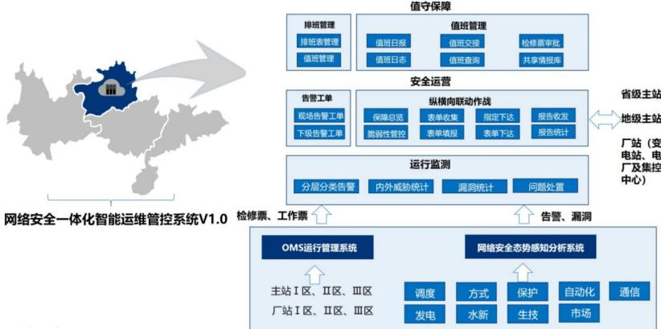

值守保障 排班管理 值班管理 排班表管理 值班日报 值班交接 检修票审批 值班管理 值班日志 值班查询 共享情报库 安全运营 告警工单 省级主站 纵横向联动作战 现场告警工单 保障总览 表单收集 指定下达 报告收发 地级主站 下级告警工单 脆弱性管控 表单填报 表单下达 报告统计 厂站（变 电站、电 运行监测 厂及集控 中心） 分层分类告警 内外威胁统计 漏洞统计 问题处置 网络安全一体化智能运维管控系统V1.0 检修票、工作票 告警、漏洞 OMS运行管理系统 网络安全态势感知分析系统 主站I区、Ⅱ区、Ⅲ区 调度 方式 保护 自动化 通信 厂站I区、 Ⅱ区、 Ⅲ区 发电 水新 生技 市场

系统的各类配置信息和定制的流程能存储在数据库中，便于备份和管理。系统具备应用级的负载均衡特性，在应用会话连接期间自动判断、切换，无需等待，以消除人工干预和信息丢失的情况。系统具有分布式部署的能力，采用分布式部署时，各流程间应无缝衔接，在数据的存储与分析上采用多种数据处理技术手段：分布式缓存、大数据存储、情境数据库，能够满足各种不同结构数据的存储分析的功能需要。

系统本身是一个开放性、模块化的系统，在硬件方面采用标准的服务器体系架构，并预留扩展空间，可通过添加内存、添加或升级CPU、升级硬盘、添加接口卡等方式，对硬件性能及存储空间进行扩容。系统采用面向服务的体系结构，建立从运行环境、编程模型、架构风格等在内的可重用、松耦合、互操作的服务体系结构，涵盖服务的整个生命周期，使系统更灵活、更易于重用、更好（也更快）地应对变化。采用组件化的分层结构设计思想，使其具有预制性、封装性、透明性、互操作性、通用性等特征，便于快速地组装新的应用。通过

1、数据架构：系统告警数据、脆弱性管控数据、装置在离线数据以及值班日报的指标数据来源于态势感知平台，通过态势感知大数据处理能力，为一体化智能运维管控系统提供重要数据支持，安全运营的告警数据、指令工单数据和脆弱性管控数据需汇总到值班日报模块。系统数据架构如下图所示：

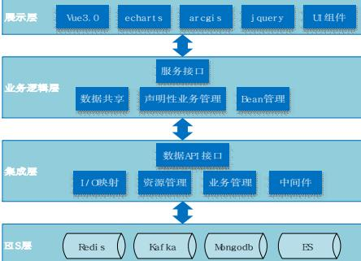

展示层 Vue3. 0 echart s arcgis j quer y UI组件 服务接口 业务逻辑层 数据共享 声明性业务管理 Bean管理 数据API接口 集成层 I/O映射 资源管理 业务管理 中间件 IS层 Redi s Kaf ka Mbngodb

2、数据处理：依托态势感知系统强大的大数据处理能力为电力监控系统网络安全一体化智能运维管控系统提供数据赋能，态势感知系统突破IOE架构，采用大数据流式计算，不停机性能平滑伸缩扩展，同时拥有“慢库”+“快库”设计，完成根据数据使用频度和业务特性进行存放，充分利用机器硬件，空间换时间、时间换空间。

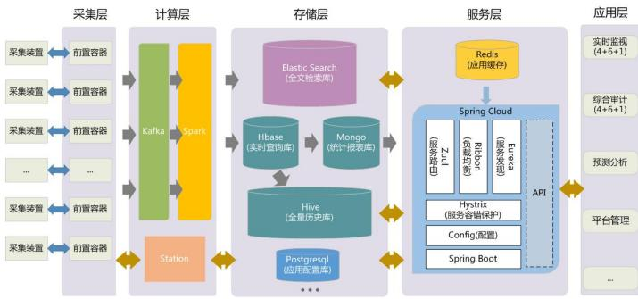

采集层 计算层 存储层 服务层 应用层 实时监视 采集装置 前置容器 Redis (4+6+1) Elastic Search （应用缓存） （全文检索库） 采集装置 前置容器 综合审计 Spring Cloud (4+6+1) 采集装置 前置容器 Kafka Spark Hbase Mongo （实时查询库） （统计报表库） （服务路由） （负载均衡） Ribbon （服务发现） Zuul Eureka 预测分析 .  API 采集装置 前置容器 Hive Hystrix （全量历史库） （服务容错保护） 平台管理 Config（配置） 采集装置 前置容器 Station Postgresql Spring Boot （应用配置库）

通过态势感知大数据分析功能对贵州全省海量安全数据进行采集、分析、处理并汇聚推送至一体化智能运维管控系统，实现“安全技术输出”与“运行管理控制”相结合的网络安全综合治理。

3、风险监测：以运营安全可视和协同防御为核心，面向“省地”的决策层、管理层、执行层多维度实现网络安全智能运维管控。省地领导通过网络安全运维全景监测视图，洞察各组织层级运维管控态势；省地业务部门重点关注本单位风险处置执行情况、推动风险处置闭环；各地业务部门管理人员重点关注威胁情报、风险隐患，快速响应处置。

## 功能点1：全景监测大屏

通过全景监测大屏可以实时跟踪管控各个问题的处置情况、工单闭环情况、告警汇总、指令闭环、攻击情况等。

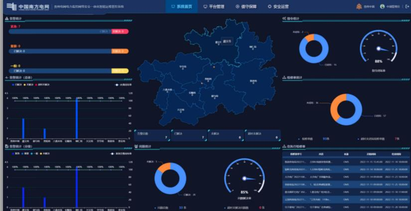

中国南方电网 电网力控网安全一体控系 系统首页 平台管理 ? 值守保障 1 安全运营   4 告管统计 指编针 O 。  O  022-11-151545.00  O 1-1 OMS 22-11-40900     2022.11.1818000 1   厂 C 2022-11-10090000 2022-11-20 180:00:00

4、安全运营：利用大数据、态势感知等智能技术手段，对各类电力监控系统多源异构日志进行采集，结合关联分析、行为分析有效发现网络资产的风险隐患和被攻击情况，对监测异常的网络安全运行事件，自动生成告警工单，智能化全流程管控，实时跟踪告警处置进度、进行处置进度提醒，推动告警处置高效闭环。

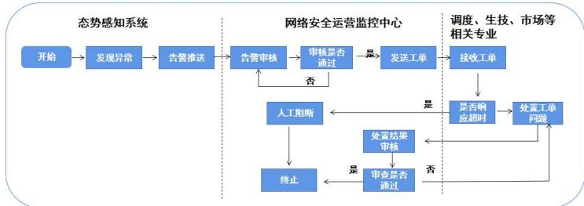

态势感知系统 网络安全运营监控中心 调度、生技、市场等 相关专业 开始 发现异常 告警推送 告警审核 审核是否 是 通过 发送工单 接收工单 香 人工阻断 是 是否响 处置工单 应超时 问题 处置结果 审核 是 审查是否 否 终止 通过

通过设置4类用户角色监测组、值长组、处置组、专家组，实现上述作用的具体承接，完成及时、高效、统一的协同响应机制，设置告警高、中、低优先级完成精准、快捷响应。

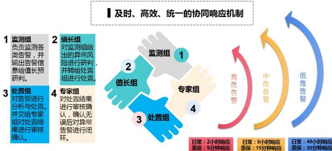

及时、 − 高效、统一的协同响应机制 监测组 2 值长组 负责监测各 对监测组给 类告警，并 出的异常风 监测组 1 输出告警信 险进行研判 息给值长预 并转给处置 研判。 组进行处置 高危告警 中危告警 低危告警 值长组 处置组 专家组 专家组 对告警进行 对处置结果 分析与处置。 进行审核确 4 并交给专家 认，确认无 组对处置结 3 处置组 误后对异常 果进行审核 告警进行闭 确认。 环。 日常：2小时响应 日常：8小时响应 日常：48小时响应 重保：5分钟响应 重保：15分钟响应 重保：30分钟响应

## 功能点1：异常监测功能

当监测组人员监测到异常告警时，可将告警工单进行推送，经过值长审核后，流转至处置组进行应急响应。

## 风险闭环操作第一步：建立工单

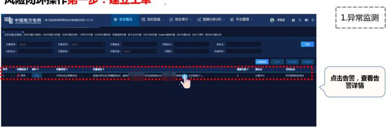

风险闭环操作第一步：建立工车 中国南方电网 安全概况 综合审计 预测分析（AI） 平台管理 1.异常监测 电力监控网安V2.10 国 实时监视  S时(  多出    警认点    告D F 点击告警，查看告 警详情

## 功能点2：风险审核功能

值长对监测组发起的工单进行审核，确认无误以后流转至处置组进行处置。

## 风险闭环操作第二步：风险审核

## 功能点3：跟踪处置功能

应急处置组查收工单后，在规定时间范围内，对异常资产、告警内容进行详细排查，完成响应以后填报排查情况，并申请工单闭环。

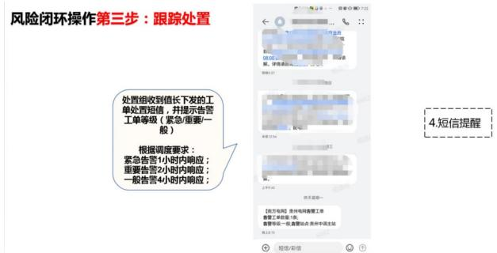

风险闭环操作第三步：跟踪处置 000M072 S 00.00 超，详错请 00527 处置组收到值长下发的工 单处置短信，并提示告警 工单等级（紧急/重要/一 4.短信提醒 般） 丰程24 根据调度要求： 紧急告警1小时内响应； 重要告警2小时内响应： 般告警4小时内响应； 1 天星期 营工数量：1 [南方电网】责电网工单 一站点贵州中调主站 1 + 信/彩信

处置人填写处置结果，并上传处置报告附件，点击“提交”提交处置结果

功能点4：闭环工单功能

专家组查收到工单以后，对工单内容进行最终确认，确认无误后对工单进行闭环。

## 风险闭环操作第四步：工单闭环

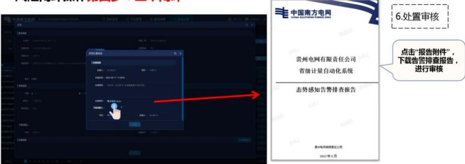

 4 丰 中国南方电网 6.处置审核 点击“报告附件” 贵州电网有限责任公司 下载告警排查报告， 省级计量自动化系统 进行审核 态势感知告警排查报告 州电网责任公司 2002年5月

风险闭环操作第四步：工单闭环

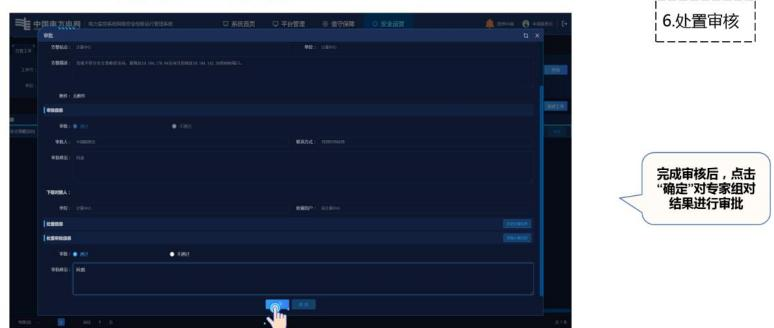

6.处置审核 1 中国方由 0 理 系统页 平台 ②值守保障 安全运营 F 3 口 X 工 0 即 N   联方 REB 完成审核后，点击 “确定”对专家组对 结果进行审批 0102 面 生

5、值守保障：充分考虑当前贵州电力监控网络安全监控中心运行值守的实际情况，解决值守保障过程中存在的口头交接、重要信息遗漏、手工记录等问题，以线上化、人性化、工单化为基本原则设计值守保障模块，使得电力监控系统网络安全值守保障业务能够严谨、高效、智能地开展。

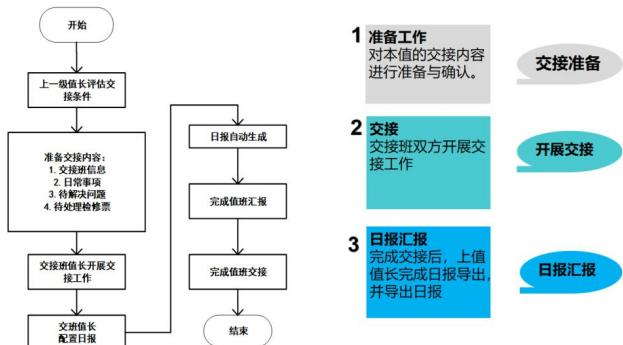

开始 1 准备工作 对本值的交接内容 交接准备 进行准备与确认。 上一级值长评估交 接条件 2 交接 日报自动生成 交接班双方开展交 开展交接 准备交接内容： 接工作 1.交接班信息 2.日常事项 3.待解决问题 4.待处理检修票 完成值班汇报 3 日报汇报 完成交接后，上值 交接班值长开展交 完成值班交接 值长完成日报导出 日报汇报 接工作 并导出日报 交班值长 配置日报 结束

功能点1：值班交接

值班交接功能可对上任值长当日待解决问题、已解决问题、检修票工单、日常工作注意事项等信息进行记录，并实现信息流转到下任值长，完成值班交接功能。

## 值班交接操作第一步：查看待交接内容

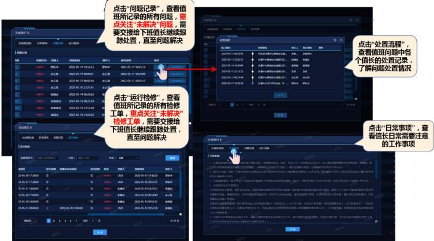

点击“问题记录”，查看值 班所记录的所有问题，重 点关注“未解决”问题，需  SSSS 要交接给下班值长继续跟 踪处置，直至问题解决  4N 交日 H  2行 日 S 点击“处置流程”  W 022-06-110820 R0  NIA BI E DA 查看值班问题中各 4 HS MA ENTH MA BRHH 0    NOA 个值长的处置记录 m0 2022-05-17 185453  2022-05-17 085516 200014104000 E   0 0 B 3 了解问题处置情况  2230S 17021  20225178250 42 20220517000216 2 20225178230 02-406-17002144 TRS NO2IF1SA  中 0 4 2022-405-6252101 4  2022-405-14 002925  2022-05-03-002224 点击“运行检修”，查看 收 2022-05-102.215320 值班所记录的所有检修 MRA 2022-05-10142303 工单，重点关注“未解决 44 检修工单，需要交接给  下班值长继续跟踪处置  点击“日常事项”，查 2u   直至问题解决 看值长日常需要注意 Su A000 的工作事项   DOmE 0 内R .  MA L江  中 开工作 F   M 23052017 自 真 CA 200-06-17 156100 FH9 1.电   252717000 。 0  OMS 4 20-61852 F0车 00-27180000 n 20-0-14012100 2 4. 2-465-20170000 西 0  209-05-14005440 42R 出压约  直行， EI  ，  2201000 西   2822051405612 BRR 0-0-11200 2020-06-201000 西 C 2000-06-1130 W 门 2 工件.  程  a行   848  Y B2s. 科程面组 X X

## 值班交接操作第二步：完成“一键”交接

2.值班交接

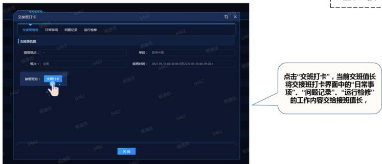

交班打卡 1111 口 X 交册信息 日常事 阿已录 运行检 6462 交息 6462 值地点： 单位： 用中调 次： 6462 值时间 2022-05-17 00:30:00.0至2022-05-18 班组： 交打卡 点击“交班打卡”，当前交班值长 6462 将交接班打卡界面中的“日常事 项”、“问题记录”、“运行检修” 的工作内容交给接班值长， 6462 6462 6462 6462 关团

## 功能点2：日报自动生成

值长完成交班以后，日报自动生成功能通过系统智能化汇总数据与文本，日报实现了从系统数据到word日报的“一键自动生成”。

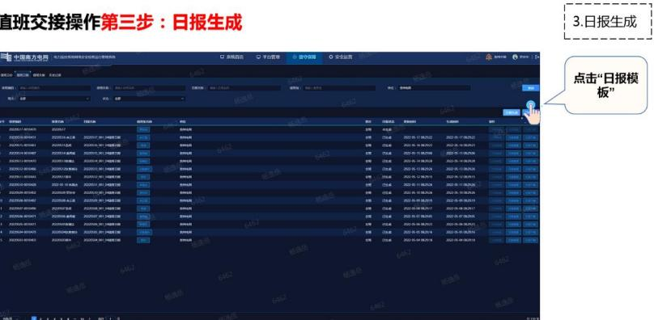

直班交接操作第三步：日报生成 3.日报生成 中国南方电网 H 系百 平台管 值守保障 安全运   分享 点击“日报模 中 板” 46   HNT 1I DERA 2 1INS 2506A7  0414 22 XSTNT 1M 1m cd 中  224A 200261702922 专 4  20208262 0 n  1 a   1 ata 2552 020 1  d 2205.12 02 2022-120 2022051782915 40 2021182 住用 2    25   20 202-02  X202917 40  2022-06.07825  -22  8    2009

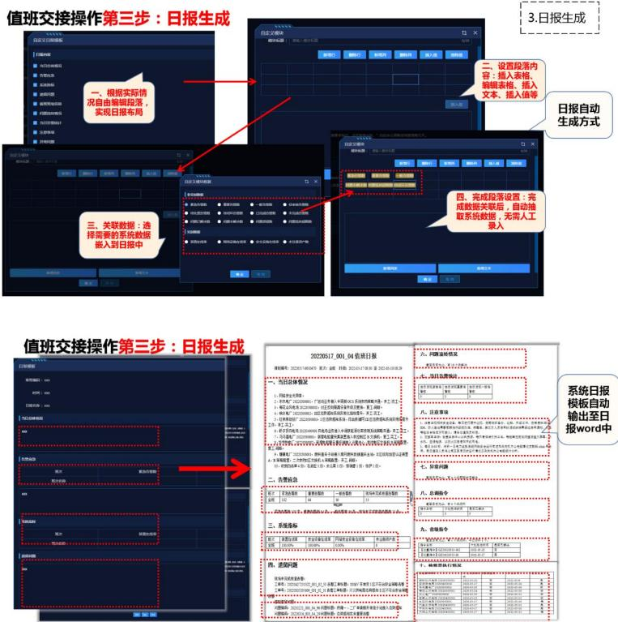

值班交接操作第三步：日报生成 3.日报生成 文日 自定文模块 口 DA 新零行 入组 二、设置段落内 容：插入表格、 编辑表格、插入 一、根据实际情 文本、插入值等 况自由编辑段落 实现日报布局 人 日报自动 生成方式 自文 A 口 N 从人 成数据关联后，自动抽 四、完成段落设置：完 取系统数据，无需人工 三、关联数据：选 录入 择需要的系统数据 嵌入到日报中  . . 文率 请定 值班交接操作第三步：日报生成 2022051700104值班日报 六转情况 N 0  一、当日总体情况  "e w " 系统日报 1.F关量 模板自动 4.响电厂22 .风电  ，更，工 注意事 输出至日 工作用工实工 2.超厂 6.于 民工 报word中  2.电厂  48.电 . 8. 1. 置，二A开工 10.石1：，：， …………… 七异章问题 二、告警应急 次 金1  福 一 场 . 八.总调令 8 H :    三、系统指标 ………………  … 九、省令 解次 全10%   ……… 1  四、遗留问题 十、输票执行况 工：  工号：2工 … 

## (二） 主要创新点

1、建立完整全面的智能化运维体系。在运行监测方面，一体化智能运维管控系统安全防护设备告警已接入范式化工程，实现对各类设备告警统一集中展示。根据态势感知系统紧急、重要、一般告警等级，按照紧急程度+告警频次自动统计、优先凸显立即处置的5个异常IP地址。系统能够自动研判的三类告警，由监测组人员一键推送工单。通过对涉及指标数据和告警响应时限由系统自动统计计算，遗留问题“一键交接”，超时未闭环的问题置顶督办，实现了强监视，全管控。

①系统投运前，值班员需手动登录各类安全设备的展示界面，对系统进行逐个检查，以便收集重要的待处理告警。然后再通过exce|表格进行登记与整理，由电话、南网elink、eSpace等方式通知对应处置单位开展紧急处置。登录各个安全设备容易费时费力，需要频繁切换账号密码进行登录，登录过程繁琐，同时各家设备告警规则不统一且设备误报较多，需要进行大量人工判断与分析。值班员通过Excel手动分析与整理告警记录、告警处置过程，表格维护的工作量较高，且容易出错。电话、eSpace、elink 通知对应责任人存在较高的沟通成本，形式零散，不利于应急管控。

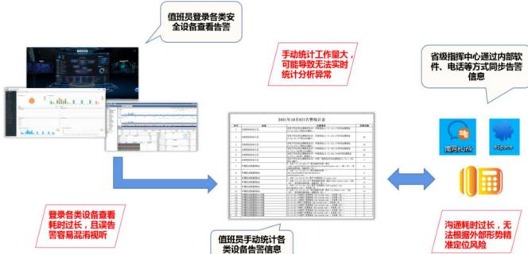

值班员登录各类安 全设备查看告警 手动统计工作量大 省级指挥中心通过内部软 可能导致无法实时 件、电话等方式同步告警 统计分析异常 信息 8 201年0月日1告规计表   1  1 Ⅱ 1 0 4 =  s 2 南网eLink espae   。   ,    404 登录各类设备查看 耗时过长，且误告 沟通耗时过长，无 警容易混淆视听 值班员手动统计各 法根据外部形势精 类设备告警信息 准定位风险

②系统投运以后，通过态势感知大数据集中分析能力，系统整合各类安全设备数据，通过智能筛选而分析诊断出最具威胁的告警信息展示至大屏。同时为值班人员提供全量数据一站式监控，重要安全态势一目了然，实现统一监视、统一分析，大大提升监控效率。

系统自动研判的三类告警，由监测组人员一键推送工单

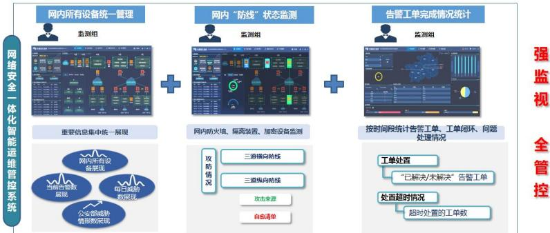

网内所有设备统一管理 网内 “防线” 状态监测 告警工单完成情况统计 监测组 监测组 监测组 网络安全一体化智能运维管控系统 强监视 重要信息集中统一 展现 网内防火墙、 隔离装置、 加密设备监测 按时间段统计告警工单、工单闭环、问题 处理情况 全管控 网内所有设 政防情况 三道横向防线 工单处置 备展现 三道纵向防线 “已解决/未解决 告警工单 当前吉警数 每日威胁 展现 数展现 攻击来源 处置超时情况 公安部威胁 自愈清单 超时处置的工单数 情报数展现

2、建立高效、协同、快速的信息化协同响应机制。在告警处置方面，系统实时监控“一键推送”形成工单，如有异常自动同步至系统生成告警工单推送异常情况。工单自动流转至处置单位进行风险审核，精准推送给处置单位，并短信提醒进行告警。按时完成处置并提交处置结果与报告后，专家下载审查处置报告并闭环工单全流程可回溯，实现了防遗漏，全闭环。

①系统投运前，值班监控人员采用word记录各类风险情况与处置过程，耗时过长，存在漏记、错记等问题，同时零散的通报渠道也不利于对处置过程全面细致地跟踪闭环，易出现“跟丢”、“漏跟”，一旦出现重要的网络安全风险被遗漏，即容易造成不可挽回的后果。

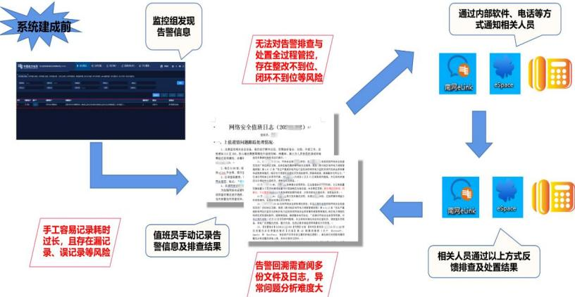

监控组发现 通过内部软件、电话等方 系统建成前 式通知相关人员 告警信息 无法对告警排查与 处置全过程管控 存在整改不到位、  闭环不到位等风险 南网elink eSpace 网络安全值班日志（20 0. 上值通间题处理  ，，，人的 1.注，，用，，， 用后还日，   1.目 10808   .  44   1.0 :  ， 12 4. hnsr 1  屏  15.1  .  F. ..8 ( S 21，以  南网elink eSpace  为2，， 手工容易记录耗时 a./ 值班员手动记录告  1.1 tuee 过长，且存在漏记 5. te   4*， 录、误记录等风险 警信息及排查结果 相关人员通过以上方式反 告警回溯需查阅多 馈排查及处置结果 份文件及日志，异 常问题分析难度大

②系统投运后，通过建机制、建流程，集“监测”、“审核”、“处置”、“闭环”四个流程于一体，各司其职分工明确，完善风险处置全过程，确保问题不遗漏、风险迅处置、过程可回溯。

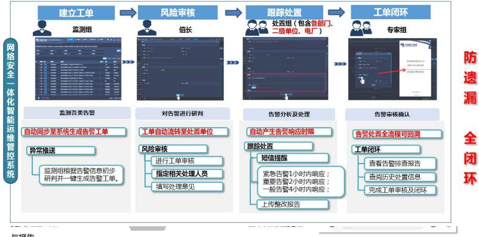

建立工单 风险审核 跟踪处置 工单闭环 处置组（包含各部门、 监测组 值长 级单位、电厂） 专家组 网络安全一体化智能运维管控系统 中 防遗漏 3 200084 teeen 0400.9040 监测备类告警 对告警进行研判 告警分析及处理 告警审核确认 自动同步至系统生成告警工单 工单自动流转至处置单位 自动产生告警响应时限 告警处置全流程可回湖 全闭环 异常推送 风险审核 跟踪处置 工单闭环 进行工单审核 短信提醒 查看告警排查报告 监测组根据告警信息初步 研判并一键生成告警工单 指定相关处理人员 紧急告警1小时内响应： 重要告警2小时内响应： 查阅历史处置信息 填写处理意见 般告警4小时内响应： 完成工单审核及闭环 上传整改报告

3、实现隐患排查与整改的全专业、全过程管控。在运行值守方面，系统能够分析当值网络安全整体运行情况，自动同步至值班日报，自动同步OMS系统检修票，与实时告警联动管控现场作业工况，超时未完成缺陷/异常处置的自动置顶督办，统计网级、省级指令响应情况，自动同步至下一值，实现完全的封键盘，全自动。

①系统投运前，上下班交接多采用口头沟通、word共享等方式进行，如此双方交接便容易出现信息失真，沟通不到位等问题，每日值班员整理的重要问题跟踪链条容易断链或走偏，造成效率低下、耗费时间。

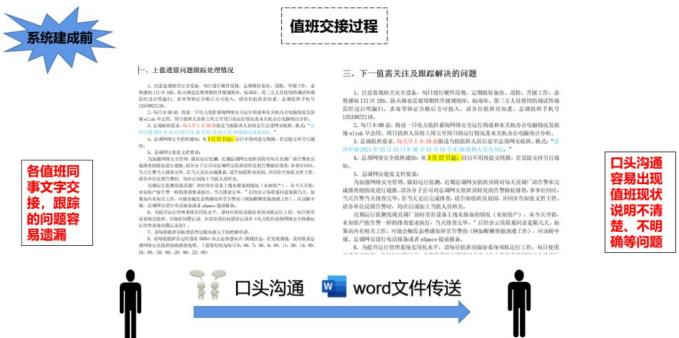

值班交接过程 系统建成前 一一、上值通留间题踪处理情况 三、下一值需关注及跟踪解决的问题 标重加口区，要理规升提理用，，人目能同的动 1.点规关定全备，进行能件，主用备份，，工， 需进消响能行，表带等有证合日有可检入，请备加查，出测手机号 感加工1区6，新大墙由要期性升规则库，海，三方人用的 1、性直能视组关安业备，每目进行带通现，定期微好备，通检，醒工，志 13000 2.每目，程一电力N网电期业关办电此发源 15533922110. 需性过后明温扫，系每等输证合整后方可接入，请各位值班员知悉，总调值班手机号 公，人上工日来天电  3.自质班要，天人热品期自 限早金，群目值人情符上周到周日的运行情况度来关期寿电服境进外断 2.每日前，将前一日电与监控最网路安全端行简建和求关机春公电脑局况发知 14.网，， 中国20年月2日月日30人 3.调镇质要求，天早上：报运当值人信意网安值，格式 5.84在要 成自点的行，语分子可网有要告要点，事 为全，有，直厂动告 加。 4.自网安全值通从月日，以后不用再交，调交再另行通 各值班同 口头沟通 事文字交 天告为无婚面金苦当无文或直，告相直直面兼同青面育士管。 告单告时，上人 5.总同网安处据文性要求： 为加强网络安全管地，财超行监测，近南总调网安值班底对每天直间厂超告警未定 容易出现 产一的行，当无，全用， 期出测直面厂达有的（加产，天 接，跟踪 内工，可能发去告（工），卡 成持查的情况题行难报，请备分子会可时总调网安能质共转发的告整微好排点，事事有回应 当天告警当天排查定中，若当天无法定成排点，请告知，并同参告知报文主。 值班现状 的问题容 m.电动. 6.为用，员工，用 请备单位反告警时，均直后加上当值人员名。 近期运行监测发现直调厂站时常有备上线未报备的现（知产》，从今天开始 说明不清 改系空，并间，发用的期记在电力能程函用发全经证 易遗漏 五要理段规向题记录数。 未加值产告警一的排查要求执行，当关在定，后经金云现同直定限儿无，加 楚、不明 7.年 4.请号检程定用直金加点用，用线，及系 果结内有相关工，可能会融度感知异常警的（例如师变程游工作），应法中 全地.（01，.110.1600 牌，总部网安进行电动提备成者g提需提备 6、为提开行管理系境安用化水甲，请镇离员时系规运程工作，每目使用 确等问题 10001000.200.200 口头沟通 word文件传送

②系统投运后，交班值班员自动记录当值情况，通过“一键交接”，完成遗留问题或待交接事项线上交接，通过线上记录、线上闭环、线上跟踪，完成每日值班数据自动汇总至日报，实现日报自动生成功能。

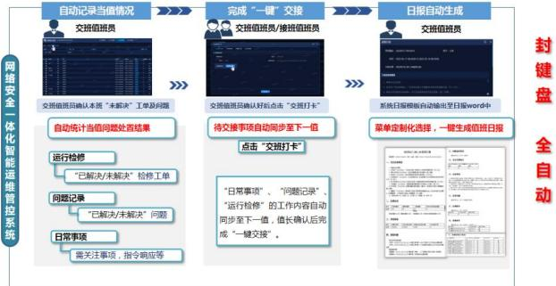

自动记录当值情况 完成“一键”交接 日报自动生成 交班值班员 交班值班员/接班值班员 交班值班员 封键盘 网络安全一体化智能运维管控系统 >> 交自班品确认本班未决”工单及间 交值品确认好后点击交打卡 统日服模板自动输出至日报od中 自动统计当值问题处百结果 待交接事项自动同步至下一值 菜单定制化选择，一键生成值班日报 点击“交班打卡” 全自动 运行检修 “已解决/未解决”检修工单 问题记录 “日常事项” “问题记录” “运行检修” 的工作内容自动  . “已解决/未解决”问题 同步至下一值，值长确认后完 日常事项 成“一键交接”。 需关注事项，指令响应等

## 四、 经济效益和社会效益

## （一） 经济效益

1、资产自动发现管理效能，节约资产管理成本。系统上线后，利用资产发现功能实现了资产的自动化全发现，协助站内人员完善了资产台账。74座变电厂计算，每年盘点两次，平均每个电厂节约4个人天。贵州中调每年预计可节约592个人天，全网平均按0.15万元/人天计算，该项工作全网每年可节约88.8万元。

2、告警自动研判，推送工单，节省人力成本。系统上线之前，对于风险监视主要是依靠人工查看日志的方式来发现，不但效率低下，还可能分析不全面，无法从根本上解决风险。贵州中调则最少需要配备3名工程师，按照平均每名工程师综合人工成本40万元/年计算，则贵州中调每年节约人工费用120万元。

3、值班规范、高效化，节省时间成本。系统根据日期对现场值班人员进行自动轮值，线上实现排班班组新建、修改、查询、删除；可根据不同责任对人员进行分组、分工管理。值班交接由原25分钟左右完成值班交接，到现在10分钟内完成值班交接。问题通报时间上：由原来每个问题需要10分钟，到现在每个问题只需10秒。日报生成：由原来每份报告预计30分钟，到现在每份报告预计1分钟。

每月可节约时间=30×[（10min-10s）×15+（30min-1min）+（25min 

-10min）]≈95.8小时。

（注：每个值班人员按日平均15个问题数、1篇日报、1次值班交接，1人每天工作8小时算）

每月可节约人天数=每月可节约时间/8h≈11.97人天。

每月全省可节省费用=11×11×11.97×750≈108.61万元。

## (二） 社会效益

1、有力支撑电力可靠供应。系统自投运以来，不仅助力贵州电网建立了横纵快速联动、异常精准管控、处置及时有效的电力监控系统网络安全运行值守体系，在2022年9月贵州严峻的疫情形势下，在全省“人员合理最小化”值班模式下，有力支撑运维人员完成了1800余条告警处置及闭环，有效保障了电力可靠供应和优质的供电服务，提升了用户对电网企业的信心，树立了良好的企业形象。

2、有效防范违法违章行为。通过系统首次实现了在线的专业技术监督，有力促进技术监督模式由现场转变为远方实时监管，极大的提高了监管效率和质量，进一步规范了网络安全专业管理和现场作业，有效杜绝违章违规网络安全行为。

3、提供坚实网络安全保障。以“防御国际级最高水平网络攻击而发动的电力战”为标尺，以“确保核心业务系统不遭受入侵”为目标，将数字技术和业务的深度融合，融合态势感知系统，实现安全业务“线上全流程”，解决了网络安全管理难、效率低等问题，创新建成安全指挥调度统一流程，实现安全防护“线上全联动”，在“分秒必争”的攻防实战中为应急处置争取了宝贵时间，圆满完成2022年国家网络攻防演习目标，为南方电网取得央企排名第二的优异成绩提供了坚强技术保障，有效促进了业务数字化转型升级，为新型电力系统建设提供了坚实的网络安全保障。

## 五、 推广应用情况

## （一） 成果优势

1、通过态势感知大数据集中分析能力，整合海量电力工控设备及安全防护设备数据，智能筛选分析诊断出最具威胁的告警信息进行展示，实现网络安全态势一目了然，全量数据一站监控，有效解决了告警监控“痛点”。

2、通过建立本系统，完善风险处置全过程，通过机制预设、建流程，集“监测”、“审核”、“处置”、“闭环”四个流程于一体，完成全专业统一联动运作，跨区域协同办公的安全运营管控得到充分发挥。

3、基于态势感知系统“数据安全底座”，仅需通过AP|接口，读取数据库的方式即可快速实现全网部署，部署成本低，满足贵州电网13家单位1475座35kV及以上变电站及74家电厂实际业务迫切需求

## （二） 推广应用情况

系统在贵州中调进行部署涉及贵州中调、兴义供电局、六盘水供电局、安顺供电局、凯里供电局、毕节供电局、信息中心、铜仁供电局、都匀供电局、贵阳供电局、计量中心、遵义供电局、电科院共13家单位及74家直调电厂取得了良好的应用效果。应用证明如下所示。

## 1、 遵义供电局

<html><body><table border="1"><tbody><tr><td>成果名称</td><td colspan="2">贵州电网电力监控系统网络安全一体化智能运维管控系统</td></tr><tr><td>应用单位</td><td colspan="2">遵义供电局</td></tr><tr><td>通讯地址</td><td colspan="2">贵州省遵义市汇川区南京路555号</td></tr><tr><td>应用成果起止时间</td><td colspan="2">自2021年12月-至今</td></tr><tr><td colspan="3">经济效益（万元）</td></tr><tr><td>年度</td><td>2021</td><td>2022</td></tr><tr><td>新增产值（产量）</td><td>/</td><td>/</td></tr><tr><td>新增利税（纯收入）</td><td>,</td><td>/</td></tr><tr><td>年增收节支总额</td><td>9.975</td><td>99.75</td></tr><tr><td colspan="4">2021年12月至今，该项目成果已在遵义供电局成功实施应用，通过信息化、智能 化手段，创新运行值守与专业管理相融合，实现电力监控系统网络安全全方位、全专 业、全过程的可视化管控，取得良好经济社会效益，具体如下： (一）经济效益 节约人力成本。系统未投运以前，安全运营值守工作未充分达到线上化、工单化、 人性化的要求，问题通报通常采取espace、电话等方式进行传达至处置单位，值班日 报通过手工编辑完成，前一轮与后一轮值班交接通过口头交换信息完成交接，每月需 要花费的时间约为163小时，系统上线以后问题通报通过告警自动短信推送，点对点 自动下达，日报自动汇总系统关键数据而实现一键生成，上下班交接通过系统自动完 成值班信息的交换确认，大大减少人力成本，每月可累计节约133小时的人力工时。 提高工作效率。异常问题处置数据分散，难以溯源追踪，问题记录不详细，难以 全面分析，风险闭环效率低。系统投运部署以后，处置数据集中，快速分析排查，问 题全过程记录，处置高效，风险闭环效率得到快速提升，每月可额外处理的异常、问 题及风险数累计304个。 （二）社会效益 真正把习近平总书记关于网络强国系列讲话精神和《网络安全法》等法规要求落 实到工程实际应用，有效增强了网络安全防御能力和威慑能力。项目成果自上线以来，</td></tr></tbody></table></body></html>

## 2、 毕节供电局

<html><body><table border="1"><tbody><tr><td>成果名称</td><td colspan="2">贵州电网电力监控系统网络安全一体化智能运维管控系统</td></tr><tr><td>应用单位</td><td colspan="2">毕节供电局</td></tr><tr><td>通讯地址</td><td colspan="2">贵州省毕节市桂花路14号</td></tr><tr><td>应用成果起止时间</td><td colspan="2">自2021年12月-至今</td></tr><tr><td colspan="3">经济效益（万元）</td></tr><tr><td>年度</td><td>2021</td><td>2022</td></tr><tr><td>新增产值（产量）</td><td>/</td><td>/</td></tr><tr><td>新增利税（纯收入）</td><td>/</td><td>,</td></tr><tr><td>年增收节支总额</td><td>11.4</td><td>98.3</td></tr><tr><td colspan="3">2021年12月至今，该项目成果已在毕节供电局成功实施应用，通过信息化、智能 化手段，创新运行值守与专业管理相融合，实现电力监控系统网络安全全方位、全专 业、全过程的可视化管控，取得良好经济社会效益，具体如下： （一）经济效益 节约人力成本。系统未投运以前，安全运营值守工作未充分达到线上化、工单化、 人性化的要求，问题通报通常采取espace、电话等方式进行传达至处置单位，值班日 报通过手工编辑完成，前一轮与后一轮值班交接通过口头交换信息完成交接，每月需 要花费的时间约为171小时，系统上线以后问题通报通过告警自动短信推送，点对点 自动下达，日报自动汇总系统关键数据而实现一键生成，上下班交接通过系统自动完 成值班信息的交换确认，大大减少人力成本，每月可累计节约138小时的人力工时。 提高工作效率。异常问题处置数据分散，难以溯源追踪，问题记录不详细，难以 全面分析，风险闭环效率低。系统投运部署以后，处置数据集中，快速分析排查，问 题全过程记录，处置高效，风险闭环效率得到快速提升，每月可额外处理的异常、问 题及风险数累计326个。 （二）社会效益 真正把习近平总书记关于网络强国系列讲话精神和《网络安全法》等法规要求落 实到工程实际应用，有效增强了网络安全防御能力和威摄能力。项目成果自上线以来，</td></tr></tbody></table></body></html>

贵州电网有限责任公司遵义供电局 电力调度控制中心

通过信息化、智能化手段，创新运行值守与专业管理相融合，在南网首家首次建成了套网络安全一体化智能运维管控系统，实现电力监控系统网络安全全方位、全专业全过程的可视化管控，彻底解决事件闭环效率低、专业协同性弱、各环节间信息不对称、信息传递不及时等问题，极大地提高监管效率和质量，进一步规范网络安全专业管理、值班纪律和异常处置流程，建立横纵快速联动、异常精准管控、处置及时有效的运行值守体系，显著提升网络安全治理水平，有效杜绝违章违规网络安全行为。

## 3、 兴义供电局

<html><body><table border="1"><tbody><tr><td colspan="3">应用证明</td></tr><tr><td>成果名称</td><td colspan="2">贵州电网电力监控系统网络安全一体化智能运维管控系统</td></tr><tr><td>应用单位</td><td colspan="2">贵州电网有限责任公司兴义供电局</td></tr><tr><td>通讯地址</td><td colspan="2">贵州省兴义市兴义供电局</td></tr><tr><td>应用成果起止时间</td><td colspan="2">自2021年12月-至今</td></tr><tr><td colspan="3">经济效益（万元）</td></tr><tr><td>年度</td><td>2021</td><td>2022</td></tr><tr><td>新增产值（产量）</td><td>/</td><td>/</td></tr><tr><td>新增利税（纯收入）</td><td>/</td><td>/</td></tr><tr><td>年增收节支总额</td><td>10.975</td><td>98.75</td></tr><tr><td colspan="3">2021年12月至今，该项目成果已在贵州电网有限责任公司兴义供电局成功实施应用， 通过信息化、智能化手段，创新运行值守与专业管理相融合，实现电力监控系统网络 安全全方位、全专业、全过程的可视化管控，取得良好经济社会效益，具体如下： （一）经济效益 节约人力成本。系统未投运以前，安全运营值守工作未充分达到线上化、工单化、 人性化的要求，问题通报通常采取espace、电话等方式进行传达至处置单位，值班日 报通过手工编辑完成，前一轮与后一轮值班交接通过口头交换信息完成交接，每月需 要花费的时间约为221小时，系统上线以后问题通报通过告警自动短信推送，点对点 自动下达，日报自动汇总系统关键数据而实现一键生成，上下班交接通过系统自动完 成值班信息的交换确认，大大减少人力成本，每月可累计节约260小时的人力工时。 提高工作效率。异常问题处置数据分散，难以溯源迫踪，问题记录不详细，难以 全面分析，风险闭环效率低。系统投运部署以后，处置数据集中，快速分析排查，问 题全过程记录，处置高效，风险闭环效率得到快速提升，每月可额外处理的异常、问 题及风险数累计126个。 （二）社会效益 真正把习近平总书记关于网络强国系列讲话精神和《网络安全法》等法规要求落 实到工程实际应用，有效增强了网络安全防御能力和威惯能力。项目成果自上线以来，</td></tr></tbody></table></body></html>

贵州电网有限责任公司毕节供电局

通过信息化、智能化手段，创新运行值守与专业管理相融合，在南网首家首次建成了 一套网络安全一体化智能运维管控系统，实现电力监控系统网络安全全方位、全专业、 全过程的可视化管控，彻底解决事件闭环效率低、专业协同性弱、各环节间信息不对 称、信息传递不及时等问题，极大地提高监管效率和质量，进一步规范网络安全专业 管理、值班纪律和异常处置流程，建立横纵快速联动、异常精准管控、处置及时有效 的运行值守体系，显著提升网络安全治理水平，有效杜绝违章违规网络安全行为。 章 四 贵 兴义供电易 年 10月30日

## 4、 安顺供电局

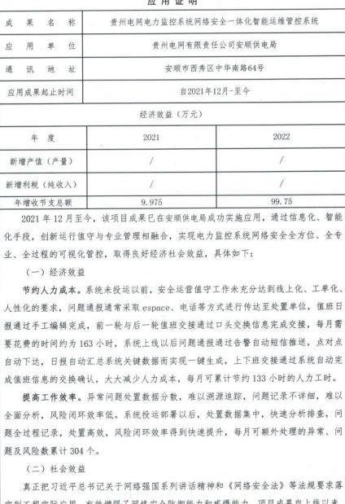

应用证明 成果名称 贵州电网电力监控系统网络安全一体化智能运维管控系统 应用 单位 贵州电网有限责任公司安顺供电局 通讯地址 安顺市西秀区中华南路64号 应用成果起止时间 自2021年12月-至今 经济效益（万元） 年度 2021 2022 新增产值（产量） / / 新增利税（纯收入） / / 年增收节支总额 9.975 99.75 2021年12月至今，该项目成果已在安顺供电局成功实施应用，通过信息化、智能 化手段，创新运行值守与专业管理相融合，实现电力监控系统网络安全全方位、全专 业、全过程的可视化管控，取得良好经济社会效益，具体如下： （一）经济效益 节约人力成本。系统未投运以前，安全运营值守工作未充分达到线上化、工单化、 人性化的要求，问题通报通常采取espace、电话等方式进行传达至处置单位，值班日 报通过手工编辑完成，前一轮与后一轮值班交接通过口头交换信息完成交接，每月需 要花费的时间约为163小时，系统上线以后问题通报通过告警自动短信推送，点对点 自动下达，日报自动汇总系统关键数据而实现一键生成，上下班交接通过系统自动完 成值班信息的交换确认，大大减少人力成本，每月可累计节约133小时的人力工时。 提高工作效率。异常问题处置数据分散，难以溯源追踪，问题记录不详细，难以 全面分析，风险闭环效率低。系统投运部署以后，处置数据集中，快速分析排查，间 题全过程记录，处置高效，风险闭环效率得到快速提升，每月可额外处理的异常、间 题及风险数累计304个。 （二）社会效益 真正把习近平总书记关于网络强国系列讲话精神和《网络安全法》等法规要求落 项目成果向上线以

通过信息化、智能化手段，创新运行值守与专业管理相融合，在南网首家首次建成了 一套网络安全一体化智能运维管控系统，实现电力监控系统网络安全全方位、全专业、 全过程的可视化管控，彻底解决事件闭环效率低、专业协同性弱、各环节间信息不对 称、信息传递不及时等问题，极大地提高监管效率和质量，进一步规范网络安全专业 管理、值班纪律和异常处置流程，建立横纵快速联动、异常精准管控、处置及时有效 的运行值守体系，显著提升网络安全治理水平，有效杜绝违章违规网络安全行为。 应用单位：（公章 可 2028 安顺供电局 日

## 5、 贵安供电局

<html><body><table border="1"><tbody><tr><td>成果名称</td><td colspan="2">贵州电网电力监控系统网络安全一体化智能运维管控系统</td></tr><tr><td>应用单位</td><td colspan="2">贵州电网有限责任公司贵安供电局</td></tr><tr><td>通讯地址</td><td colspan="2">贵阳市花溪区贵安新区天河潭大道贵安供电局</td></tr><tr><td>应用成果起止时间</td><td colspan="2">自2021年12月-至今</td></tr><tr><td colspan="3">经济效益（万元）</td></tr><tr><td>年，度 w</td><td>2021</td><td>2022</td></tr><tr><td>新增产值（产量）</td><td>,</td><td>/</td></tr><tr><td>新增利税（纯收入）</td><td>/</td><td>,</td></tr><tr><td>年增收节支总额</td><td>4.95</td><td>49.50</td></tr><tr><td colspan="4">2021年12月至今，该项目成果已在贵安供电局成功实施应用，通过信息化、智 能化手段，创新运行值守与专业管理相融合，实现电力监控系统网络安金全方位、全 专业、全过程的可视化管控，取得良好经济社会效益，具体如下： （一）经济效益 节约人力成本。系统未投运以前，安全运营值守工作未充分达到线上化、工单化、 人性化的要求，问题通报通常采取espace、电话等方式进行传达至处置单位，值班日 报通过手工编辑完成，前一轮与后一轮值班交接通过口头交换信息完成交接，每月需 要花费的时间约为81小时，系统上线以后问题通报通过告警自动短信推送，点对点自 动下达，日报自动汇总系统关键数据而实现一键生成，上下班交接通过系统自动完成 值班信息的交换确认，大大减少人力成本，每月可累计节约66小时的人力工时。 提高工作效率。异常问题处置数据分散，难以溯源追踪，问题记录不详细，难以 全面分析，风险闭环效率低。系统投运部署以后，处置数据集中，快速分析排查，问 题全过程记录，处置高效，风险闭环效率得到快速提升，每月可额外处理的异常、问 题及风险数累计152个。 （二）社会效益 真正把习近平总书记关于网络强国系列讲话精神和《网络安全法》等法规要求落 实到工程实际应用，有效增强了网络安全防御能力和威摄能力。项目成果自上线以来，</td></tr></tbody></table></body></html>

通过信息化、智能化手段，创新运行值守与专业管理相融合，在南网首家首次建成了 一套网络安全一体化智能运维管控系统，实现电力监控系统网络安全全方位、全专业、 全过程的可视化管控，彻底解决事件闭环效率低、专业协同性弱、各环节间信息不对 称、信息传递不及时等问题，极大地提高监管效率和质量，进一步规范网络安全专业 管理、值班纪律和异常处置流程，建立横纵快速联动、异常精准管控、处置及时有效 的运行值守体系，显著提升网络安全治理水平，有效杜绝违章违规网络安全行为。 有限 电票 应用单位：（公章 2028安供电局

## 6、 凯里供电局

<html><body><table border="1"><tbody><tr><td>成果名</td><td colspan="2">贵州电网电力监控系统网络安全一体化智能运维管控系统</td></tr><tr><td>应用单 位</td><td colspan="2">凯里供电局</td></tr><tr><td>通讯地址</td><td colspan="2">贵州省黔东南州凯里市宁波西路3号</td></tr><tr><td>应用成果起止时间</td><td colspan="2">自2021年12月-至今</td></tr><tr><td colspan="3">经济效益（万元）</td></tr><tr><td>年度</td><td>2021</td><td>2022</td></tr><tr><td>新增产值（产量）</td><td>/</td><td>/</td></tr><tr><td>新增利税（纯收入）</td><td></td><td>/</td></tr><tr><td>年增收节支总额</td><td>9.975</td><td>99.75</td></tr><tr><td colspan="3">2021年12月至今，该项目成果已在凯里供电局成功实施应用，通过信息化、智能 化手段，创新运行值守与专业管理相融合，实现电力监控系统网络安全全方位、全专 业、全过程的可视化管控，取得良好经济社会效益，具体如下： （一）经济效益 节约人力成本。系统未投运以前，安全运营值守工作未充分达到线上化、工单化、 人性化的要求，问题通报通常采取espace、电话等方式进行传达至处置单位，值班日 报通过手工编辑完成，前一轮与后一轮值班交接通过口头交换信息完成交接，每月需 要花费的时问约为162小时，系统上线以后问题通报通过告警自动短信推送，点对点 自动下达，日报自动汇总系统关键数据而实现一键生成，上下班交接通过系统自动完 成值班信息的交换确认，大大减少人力成本，每月可累计节约122小时的人力工时。 提高工作效率。异常问题处置数据分散，难以溯源追踪，问题记录不详细，难以 全面分析，风险闭环效率低。系统投运部署以后，处置数据集中，快速分析排查，问 题全过程记录，处置高效，风险闭环效率得到快速提升，每月可额外处理的异常、问 题及风险数累计297个。 （二）社会效益 真正把习近平总书记关于网络强国系列讲话精神和《网络安全法》等法规要求落 实到工程实际应用，有效增强了网络安全防御能力和威慢能力。项目成果自上线以来，</td></tr></tbody></table></body></html>

通过信息化、智能化手段，创新运行值守与专业管理相融合，在南网首家首次建成了 一套网络安全一体化智能运维管控系统，实现电力监控系统网络安全全方位、全专业、 全过程的可视化管控，彻底解决事件闭环效率低、专业协同性弱、各环节间信息不对 称、信息传递不及时等问题，极大地提高监管效率和质量，进一步规范网络安全专业 管理、值班纪律和异常处置流程，建立横纵快速联动、异常精准管控、处置及时有效 的运行值守体系，显著提升网络安全治理水平，有效杜绝违章违规网络安全行为。 应用单位： 照 国 子 9 凯里供电刷 30 日

## 7、 都匀供电局

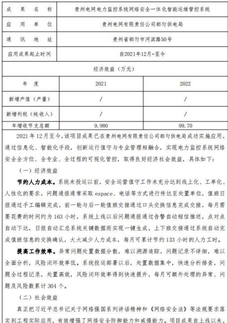

成果名称 贵州电网电力监控系统网络安全一体化智能运维管控系统 应用单位 贵州电网有限责任公司都匀供电局 通讯地址 贵州省都匀市河滨路50号 应用成果起止时间 自2021年12月-至今 经济效益（万元） 年度 2021 2022 新增产值（产量） 7 / 新增利税（纯收入） / / 年增收节支总额 9.980 99.70 2021年12月至今，该项目成果已在贵州电网有限责任公司都匀供电局成功实施应用， 通过信息化、智能化手段，创新运行值守与专业管理相融合，实现电力监控系统网络 安全全方位、全专业、全过程的可视化管控，取得良好经济社会效益，具体如下： （一）经济效益 节约人力成本。系统未投运以前，安全运营值守工作未充分达到线上化、工单化、 人性化的要求，问题通报通常采取espace、电话等方式进行传达至处置单位，值班日 报通过手工编辑完成，前一轮与后一轮值班交接通过口头交换信息完成交接，每月需 要花费的时间约为163小时，系统上线以后问题通报通过告警自动短信推送，点对点 自动下达，日报自动汇总系统关键数据而实现一键生成，上下班交接通过系统自动完 成值班信息的交换确认，大大减少人力成本，每月可累计节约133小时的人力工时。 提高工作效率。异常问题处置数据分散，难以溯源追踪，问题记录不详细，难以 全面分析，风险闭环效率低。系统投运部署以后，处置数据集中，快速分析排查，问 题全过程记录，处置高效，风险闭环效率得到快速提升，每月可额外处理的异常、问 题及风险数累计304个。 （二）社会效益 真正把习近平总书记关于网络强国系列讲话精神和《网络安全法》等法规要求落 实到工程实际应用，有效增强了网络安全防御能力和威摄能力。项目成果自上线以来，

通过信息化、智能化手段，创新运行值守与专业管理相融合，在南网首家首次建成了 一套网络安全一体化智能运维管控系统，实现电力监控系统网络安全全方位、全专业、 全过程的可视化管控，彻底解决事件闭环效率低、专业协同性弱、各环节问信息不对 称、信息传递不及时等问题，极大地提高监管效率和质量，进一步规范网络安全专业 管理、值班纪律和异常处置流程，建立横纵快速联动、异常精准管控、处置及时有效 的运行值守体系，显著提升网络安全治理水平，有效杜绝违章违规网络安全行为。 应用单位：  电网 2都匀供电局 日

## 8、 六盘水供电局

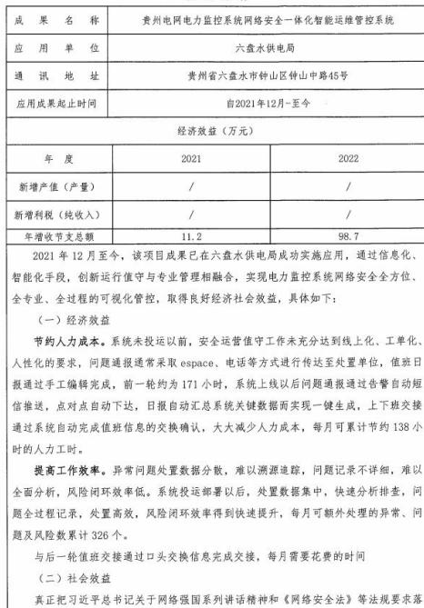

成果名称 贵州电网电力监控系统网络安全一体化智能运维管控系统 应用 单 六盘水供电局 通讯地址 贵州省六盘水市钟山区钟山中路45号 应用成果起止时问 自2021年12月-至今 经济效益（万元） 年度 2021 2022 新增产值（产量） / / 新增利税(纯收入) / / 年增收节支总额 11.2 98.7 2021年12月至今，该项目成果已在六盘水供电局成功实施应用，通过信息化、 智能化手段，创新运行值守与专业管理相融合，实现电力监控系统网络安全全方位、 全专业、全过程的可视化管控，取得良好经济社会效益，具体如下： （一）经济效益 节约人力成本。系统未投运以前，安全运营值守工作未充分达到线上化、工单化 人性化的要求，问题通报通常采取espace、电话等方式进行传达至处置单位，值班日 报通过手工编辑完成，前一轮约为171小时，系统上线以后问题通报通过告警自动短 信推送，点对点自动下达，日报自动汇总系统关键数据而实现一键生成，上下班交接 通过系统自动完成值班信息的交换确认，大大减少人力成本，每月可累计节约138小 时的人力工时。 提高工作效率。异常问题处置数据分散，难以溯源追踪，问题记录不详细，难以 全面分析，风险闭环效率低。系统投运部署以后，处置数据集中，快速分析排查，问 题全过程记录，处置高效，风险闭环效率得到快速提升，每月可额外处理的异常、问 题及风险数累计326个。 与后一轮值班交接通过口头交换信息完成交接，每月需要花费的时间 （二）社会效益 真正把习近平总书记关于网络强国系列讲话精神和《网络安全法》等法规要求落

实到工程实际应用，有效增强了网络安全防御能力和威慑能力。项目成果自上线以来， 通过信息化、智能化手段，创新运行值守与专业管理相融合，在南网首家首次建成了 一套网络安全一体化智能运维管控系统，实现电力监控系统网络安全全方位、全专业、 全过程的可视化管控，彻底解决事件闭环效率低、专业协同性弱、各环节问信息不对 称、信息传递不及时等问题，极大地提高监管效率和质量，进一步规范网络安全专业 管理、值班纪律和异常处置流程，建立横纵快速联动、异常精准管控、处置及时有效 的运行值守体系，显著提升网络安全治理水平，有效杜绝违章违规网络安全行为。 限有限 分 2 青 应用 单： 章）六盘水 供电局 贵 2022 

## 9、 贵阳供电局

应用证明

<html><body><table border="1"><tbody><tr><td>成果名称</td><td colspan="2">贵州电网电力监控系统网络安全一体化智能运维管控系统</td></tr><tr><td>应用单位</td><td colspan="2">贵阳供电局</td></tr><tr><td>通讯地址</td><td colspan="2">贵阳市云岩区中华北路186号</td></tr><tr><td>应用成果起止时间</td><td colspan="2">自2021年12月-至今</td></tr><tr><td colspan="3">经济效益（万元）</td></tr><tr><td>年度</td><td>2021</td><td>2022</td></tr><tr><td>新增产值（产量）</td><td>/</td><td>/</td></tr><tr><td>新增利税（纯收入）</td><td>1</td><td>/</td></tr><tr><td>年增收节支总额</td><td>9.875</td><td>99.85</td></tr><tr><td colspan="3">2021年12月至今，该项目成果已在贵阳供电局成功实施应用，通过信息化、智能 化手段，创新运行值守与专业管理相融合，实现电力监控系统网络安全全方位、全专 业、全过程的可视化管控，取得良好经济社会效益，具体如下： （一）经济效益 节约人力成本。系统未投运以前，安全运营值守工作未充分达到线上化、工单化、 人性化的要求，问题通报通常采取espace、电话等方式进行传达至处置单位，值班日 报通过手工编辑完成，前一轮与后一轮值班交接通过口头交换信息完成交接，每月需 要花费的时间约为160小时，系统上线以后问题通报通过告警自动短信推送，点对点 自动下达，日报自动汇总系统关键数据而实现一键生成，上下班交接通过系统自动完 成值班信息的交换确认，大大减少人力成本，每月可累计节约130小时的人力工时。 提高工作效率。异常问题处置数据分散，难以溯源追踪，问题记录不详细，难以 全面分析，风险闭环效率低。系统投运部署以后，处置数据集中，快速分析排查，问 题全过程记录，处置高效，风险闭环效率得到快速提升，每月可额外处理的异常、问 题及风险数累计300个。 (二）社会效益 真正把习近平总书记关于网络强国系列讲话精神和《网络安全法》等法规要求落 实到工程实际应用，有效增强了网络安全防御能力和威慢能力。项目成果自上线以来，</td></tr></tbody></table></body></html>

通过信息化、智能化手段，创新运行值守与专业管理相融合，在南网首家首次建成了 一套网络安全一体化智能运维管控系统，实现电力监控系统网络安全全方位、全专业、 全过程的可视化管控，彻底解决事件闭环效率低、专业协同性弱、各环节问信息不对 称、信息传递不及时等问题，极大地提高盐管效率和质量，进一步规范网络安全专业 管理、值班纪律和异常处置流程，建立横纵快速联动、异常精准管控、处置及时有效 的运行值守体系，显著提升网络安全治理水平，有效杜绝违章违规网络安全行为。 应用单 公章） 贵阳供电局

10、铜仁供电局

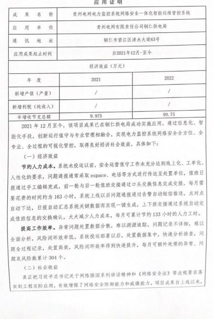

应用证明 成果名称 贵州电网电力监控系统网络安全一体化智能运维管控系统 应用单位 贵州电网有限责任公司钢仁供电局 通讯地址 铜仁市碧江区清水大道63号 应用成果起止时间 自2021年12月-至今 经济效益（万元） 年度 2021 2022 新增产值（产量） , / 新增利税（纯收入） , / 年增收节支总额 9.975 99.75 2021年12月至今，该项目成果已在铜仁供电局成功实施应用，通过信息化、智 能化手段，创新运行值守与专业管理相融合，实现电力监控系统网络安全全方位、全 专业、全过程的可视化管控，取得良好经济社会效益，具体如下： （一）经济效益 节约人力成本。系统未投运以前，安全运营值守工作未充分达到线上化、工单化、 人性化的要求，问题通报通常采取espace、电话等方式进行传达至处置单位，值班日 报通过手工编辑完成，前一轮与后一轮值班交接通过口头交换信息完成交接，每月需 要花费的时问约为163小时，系统上线以后问题通报通过告警自动短信推送，点对点 自动下达，日报自动汇总系统关键数据而实现一键生成，上下班交接通过系统自动完 成值班信息的交换确认，大大减少人力成本，每月可累计节约133小时的人力工时。 提高工作效率。异常问题处置数据分散，难以潮源追踪，问题记录不详细，难以 全面分析，风险闭环效率低，系统投运部署以后，处置数据集中，快速分析排查，问 题全过程记录，处置高效，风险闭环效率得到快速提升，每月可额外处理的异常，问 题及风险数累计304个。 (二）社会效益 真正把习近平总书记关于网络强国系列讲话精神和《网络安全法》等法规要求落 实到工程实际应用，有效增强了网络安全防御能力和威摄能力。项目成果自上线以来，

