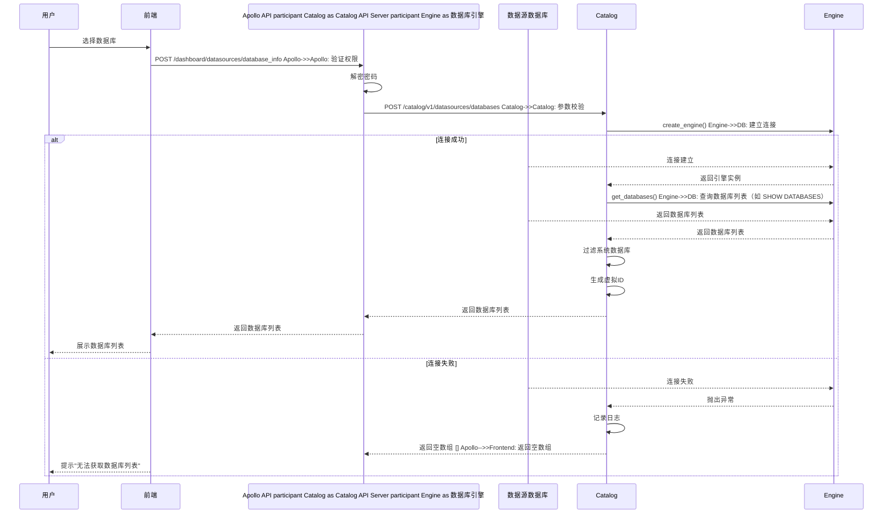

# 常见问题
#### linux给claude最高权限，省略权限询问

```
export IS_SANDBOX=1
```

```
claude --dangerously-skip-permissions --continue
```

linux，发现claude code有国家限制

在~/.claude.json 增加，参考脚本：http://code.sangfor.org/33214/dsp-tools/blob/master/dev/dev_build.sh
```
"hasCompletedOnboarding": true
```

# mcp

### 增加mcp

##### 全局mcp

在/Users/wjx/.claude.json目录，这个里面查找"mcpServers"字段，增加mcp配置文件

例如增加gitlab这个mcp，
```
    "gitlab": {
      "command": "npx",
      "args": [
        "-y",
        "@zereight/mcp-gitlab"
      ],
      "env": {
        "GITLAB_PERSONAL_ACCESS_TOKEN": "4NmSK_Z1uQxJg4Hb46BL",
        "GITLAB_API_URL": "http://code.sangfor.org/api/v4",
        "GITLAB_READ_ONLY_MODE": "false",
        "USE_GITLAB_WIKI": "false",
        "USE_MILESTONE": "false",
        "USE_PIPELINE": "false",
        "GITLAB_API_VERSION": "v4",
        "GITLAB_LEGACY_MODE": "true",
        "GITLAB_IS_OLD": "true"
      }
    },
```

##### 项目mcp

类似如下，这是当前项目的mcp配置，在这里加
```
    "/Users/wjx/Documents/1111-需求": {
      "allowedTools": [],
      "disabledMcpjsonServers": [],
      "enabledMcpjsonServers": [],
      "exampleFiles": [],
      "hasClaudeMdExternalIncludesApproved": false,
      "hasClaudeMdExternalIncludesWarningShown": false,
      "hasTrustDialogAccepted": false,
      "lastTotalWebSearchRequests": 0,
      "mcpContextUris": [],
      "mcpServers": {
        "apidog": {
```

### 常用mcp安装
##### qianliu-ci
  1. **创建打包任务** → 指定仓库和分支

  2. **触发编译打包** → 执行流水线阶段

  3. **查看构建日志** → 获取镜像地址

  4. **查询历史记录** → 排查构建问题
增加
```
"qianliu-ci": {  
  "type": "http",  
  "url": "http://10.74.167.79:9000/mcp/"  
}
```

## 插件
/pr-review-toolkit:review-pr
官方插件

## 1.skill的使用
### 插件广场安装官方skills
`/plugin marketplace add anthropics/skills`
https://github.com/anthropics/skills?tab=readme-ov-file
安装skills会自动识别，适用于重复性的技能，比如创建ppt文件，这是重复性的技能
![[截屏2025-11-28 22.45.03.png|500]]

# 2.skills的创建
https://support.claude.com/en/articles/12512198-how-to-create-custom-skills
自动创建skills的项目：
https://github.com/yusufkaraaslan/Skill_Seekers
（**几分钟内自动将文档网站、GitHub 仓库和 PDF 转换为 Claude AI 技能。**）
### 创建 Skill.md 文件

每个技能都包含一个目录，其中至少包含一个 Skill.md 文件，它是技能的核心。该文件必须以 YAML 前置元数据开头，用于存放名称和描述字段，这些是必需的元数据。它还可以包含其他元数据、Claude 指令或参考文件、可执行脚本或工具。
### 必填元数据字段

**名称：**技能的易懂名称（最多 64 个字符）

- **示例：**品牌指南

**描述：**对该技能的作用以及何时使用该技能的清晰描述。

- 这至关重要——克劳德会利用这一点来决定何时发动你的技能（最多 200 个字符）。
- **例如：**将 Acme Corp 品牌指南应用于演示文稿和文档，包括官方颜色、字体和徽标的使用。
### 可选元数据字段

**版本：**跟踪技能迭代过程中的版本。

- **示例：** 1.0.0

**依赖项：**您的技能所需的软件包。

- **例如：** python>=3.8，pandas>=1.5.0
Skill.md 文件中的元数据是渐进式披露系统的第一级，它提供了足够的信息，让 Claude 知道何时应该使用该技能，而无需加载所有内容。
### Markdown 正文
Markdown 正文是元数据之后的第二层详细信息，因此 Claude 会在读取元数据后根据需要访问它。根据您的任务，Claude 可以访问 Skill.md 文件并使用该技能。
### 示例技能.md
**品牌指南技能**
```
## 元数据  
名称：品牌指南  
描述：将 Acme 公司品牌指南应用于所有演示文稿和文档  
版本：1.0.0   
## 概述  
此技能提供 Acme 公司官方品牌指南，用于创建一致且专业的材料。在创建演示文稿、文档或营销材料时，请应用这些标准，以确保所有输出均符合 Acme 的视觉识别。Claude 在创建代表 Acme 公司的对外材料或文档时，应参考这些指南。  
## 品牌颜色  

我们的官方品牌颜色如下：  
- 主色：#FF6B35（珊瑚色）  
- 辅助色：#004E89（海军蓝）  
- 强调色：#F7B801（金色）  
- 中性色：#2E2E2E（炭灰色）  
  
## 字体 标题  
  
：Montserrat 粗体  
正文：Open Sans 常规  
字体 字号指南：  
- H1：32 磅  
- H2：24 磅  
- 正文：11 磅  
  
## 徽标使用  
  
在浅色背景上始终使用全彩徽标。在深色背景上使用白色徽标。标志周围至少保持 0.5 英寸的间距。  
  
## 适用场景  
  
在创建以下文件时请遵循这些准则：  
- PowerPoint 演示文稿  
- 用于外部共享的 Word 文档  
- 营销材料  
- 客户报告  
  
## 资源  
  
请查看资源文件夹以获取标志文件和字体下载。
```
## 添加脚本

对于更高级的技能，请将可执行代码文件附加到[Skill.md 文件](http://skill.md/)中，以便 Claude 可以运行代码。例如，我们的文档技能使用了以下编程语言和软件包：

- Python（pandas、numpy、matplotlib）
    
- JavaScript/ [Node.js](http://node.js/)
    
- 用于辅助文件编辑的软件包
    
- 可视化工具
## 包装你的技能

技能文件夹完成后：

1. 请确保文件夹名称与您的技能名称一致。
    
2. 将文件夹创建为 ZIP 文件
    
3. ZIP文件的根目录应该包含Skill文件夹（而不是子文件夹）。
    

**正确结构：**

我的技能.zip（使用与团队开发）
└── 我的技能/

├── 技能.md

└── 资源/
#### 本地开发
上面是打包的格式，本地不用zip压缩包，skills统一放在/Users/wjx/.claude/skills文件夹，必须是

```
└──技能名称/
├── examples(可选，是例子)
├── scripts(可选，是脚本)
├──resources/(可选，是资源)
├── SKILL.md
```
![[截屏2025-11-28 23.41.32.png|300]]

**结构错误：**

我的技能.zip

└──（文件直接位于 ZIP 根目录）


#### 3.AI绘制图表

##### Mermaid 的 sequenceDiagram（序列图）
![[截屏2026-02-03 10.11.22.png]]





##### Mermaid 流程图（flowchart）
```code
graph TB  
    APOLLO[Apollo API]    SVC[Catalog Service<br/>ClusterIP: 8081]    DB[(数据源数据库)]  
  
    subgraph POD["Catalog Pod"]        subgraph API_CONTAINER["api-server容器"]  
            API[FastAPI服务<br/>端口: 8081]  
            ENGINE1[数据库引擎层]  
            API --> ENGINE1        end  
        subgraph CATALOG_CONTAINER["catalog容器 run.py"]            SCHED[任务调度器<br/>定时扫描]  
            ENGINE2[数据库引擎层]  
            SCHED --> ENGINE2        end  
        SHARED["共享资源:<br/>网络 localhost<br/>存储 ConfigMap"]    end  
    APOLLO -->|HTTP请求| SVC  
    SVC -->|负载均衡| API  
    ENGINE1 -->|数据库连接| DB  
    ENGINE2 -->|数据库连接| DB  
  
    API -.共享.-> SHARED  
    SCHED -.共享.-> SHARED  
  
    style API fill:#9f9,stroke:#333,stroke-width:2px    style SCHED fill:#bbf,stroke:#333,stroke-width:2px    style SVC fill:#ff9,stroke:#333,stroke-width:3px    style SHARED fill:#ffd,stroke:#333,stroke-width:2px,stroke-dasharray: 5 5    style POD fill:#f5f5f5,stroke:#666,stroke-width:2px    style API_CONTAINER fill:#e8f5e9,stroke:#4caf50,stroke-width:2px    style CATALOG_CONTAINER fill:#e3f2fd,stroke:#2196f3,stroke-width:2px  
```


# 3.Hook

![[截屏2026-03-20 17.21.54.png]]

```
帮我配置一个hook，当claude执行完当前的指令的时候，使用 PowerShell 通过 .NET 的 Windows Forms 显示原生消息框
```

# Skill推荐

##### 自动化测试用例
得标记自动化才行
分享一个自动执行用例、检查用例失败根因、根据根因修改用例、修改代码、打包、单包替换到环境的用例自闭环skill，
刚才测出了一个小bug，已经自动修复了。
大家可以体验一下，还在初级阶段，效果需要大家一起提意见，打磨。

文档在这里 
https://wiki.sangfor.com/pages/viewpage.action?pageId=261199296 

安装方法：
npx ainative@latest install plugin https://git.sangfor.com/dsp/ai-native/plugins:SDD
使用方法：

/SDD:auto-test  <测试任务链接> 

可以下班前执行以下，让claude猛猛加班 /SDD:auto-test  <测试任务链接> 过程中不要问我任何问题，用例有问题就改用例，代码有问题就改代码，明天早上我来要看到所有用例都正确通过

### 幻觉问题

![[截屏2026-04-15 16.10.51.png]]